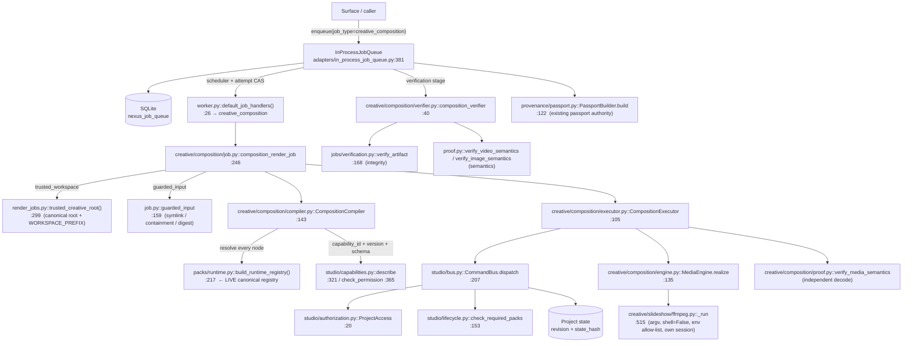

# CANONICAL_INFRASTRUCTURE_AUDIT — NEXUS AI Agent

**Gate 1 deliverable** of the NAGAR Creative Capability Composition Runtime integration.
Branch: `arena/da6837a6-nexus-ai-agent` · Base SHA: `5ed6d4e10be55f5baf5e9f2a8aa99775577621db` (== `origin/main`)

Every line number below was read from the working tree at the base SHA **plus** this
branch's committed/uncommitted changes, and every test result was produced by
running the named command in this environment. Items that are *not* proven by a
live run are labelled **`INFERRED`** and say why.

---

## 0. How this audit was produced

| Step | Command | Result |
|---|---|---|
| Repo state | `git branch --show-current && git log --oneline -1` | `arena/da6837a6-nexus-ai-agent` @ `5ed6d4e` |
| Clone depth | `git fetch --unshallow --no-tags origin` | full clone |
| Board | `python scripts/agent_board.py check --repo bot523h/nexus-ai-agent` | exit 0 (46 sources, no overlap) |
| Environment | `python -V`, `nproc`, `free -m`, `df -h .` | Python 3.11.2 · 2 CPU · 3939 MB RAM · 21 GB disk · **no GPU** |
| Media tools | `which ffmpeg ffprobe` → not found; `resolve_ffmpeg_bin()` | `/…/imageio_ffmpeg/binaries/ffmpeg-linux-x86_64-v9.0.2` |
| FFmpeg build | `ffmpeg -version` | `ffmpeg version n9.0.2-17-g2a571b6068-20260930` |
| FFmpeg build flags | `ffmpeg -buildconf` | `--enable-gpl --enable-version3 --enable-libx264 --enable-libx265 …` (**no** `--enable-nonfree`) |

The canonical registry at the base SHA carried **57** operations across six builtin
packs. This branch adds the seventh pack (`nexus.media.transform`, 3 operations),
so the live surface is **60 operations**.

---

## 1. The eight-axis audit

### Axis 1 — Capability Registry & Pack Runtime

| Domain | Owner File/Class | Relevant Methods | Call Site | Authoritative Test | Gap | Required Change |
|---|---|---|---|---|---|---|
| Operation contract | `src/nexus_ai_agent/creative/studio/capabilities.py:94` `OperationSpec` | `is_composable` (:133), `media_input` (:137), `media_output` (:143), `media_contract` (:150), `effective_permissions` (:157) | `CommandBus._dispatch_locked` → `registry.get_spec` (`bus.py:225`) | `tests/unit/test_capability_registry.py` | **GAP**: `OperationSpec` had no media ports, so a composition had nothing to type-check against and no way to declare a derived capability's dataflow | **DONE (this branch)**: added `media_inputs`, `media_outputs` (typed `MediaPort`/`MediaContract`) and `media_derived_fields` |
| Registry | `src/nexus_ai_agent/creative/studio/capabilities.py:233` `CapabilityRegistry` | `register_operation` (:246), `get_spec` (:309), `describe` (:321), `check_capability` (:338), `check_permission` (:365) | `CommandBus._dispatch_locked` (`bus.py:225`, `:265`, `:283`) | `tests/unit/test_capability_registry.py`, `tests/architecture/test_capability_registry_contract.py` | **GAP**: `register_operation` accepted two operations that declared the same media port name, making a binding ambiguous | **DONE**: `register_operation` now rejects duplicate media input/output port names (`capabilities.py:283-289`) |
| Pack composition | `src/nexus_ai_agent/creative/packs/runtime.py:141` `COMPOSITION` | `build_runtime_registry` (:217), `build_pack_registry` (:239), `composition_issues`, `stale_capabilities` | `cli.py:534 _packs_registry()`; `creative/render_jobs.py:511 build_job_bus`; `creative/composition/compiler.py` `CompositionCompiler.__init__` | `tests/architecture/test_pack_activation_completeness.py` | **GAP**: no pack could express a *media* capability, so `resize` / `grayscale` / `image_to_video` had to live outside the registry | **DONE**: new `creative/packs/media/` pack (3 ops) + `PackComposition("media", "nexus.media.transform", …)` (`runtime.py:116`, `:141`) |
| Pack manifest | `src/nexus_ai_agent/creative/packs/media/pack.manifest.json` | data-only schema `nexus.capability-pack.v1` | `packs/manifest.py::load_manifest` | `tests/architecture/test_pack_manifest_is_data_only.py` | none | none |
| Pack lifecycle | `src/nexus_ai_agent/creative/studio/lifecycle.py:92` `PACK_LIFECYCLE` | `pack_lifecycle` (:143), `check_required_packs` (:153) | `CommandBus._dispatch_locked` (`bus.py:272`) | `tests/architecture/test_lifecycle_gate_boundary.py` | **GAP**: `nexus.media.transform` was unknown → fail-closed | **DONE**: `PACK_LIFECYCLE["nexus.media.transform"] = AVAILABLE` |

**Live measurement** (this environment, after this branch's changes):

```
TOTAL OPS: 60
MEDIA OPS: ['media.grayscale_image', 'media.image_to_video', 'media.pause', 'media.play', 'media.resize_image']
composition_issues: ()
stale: {}
```

### Axis 2 — Policy, Authority & Actor Authorization

| Domain | Owner File/Class | Relevant Methods | Call Site | Authoritative Test | Gap | Required Change |
|---|---|---|---|---|---|---|
| Authority | `src/nexus_ai_agent/creative/studio/authorization.py:20` `ProjectAccess` | `authorize` (:27), `require_permissions` (:32) | `CommandBus._dispatch_locked` (`bus.py:257`) | `tests/unit/test_studio_authorization.py` | none — the composition layer **must not** add a permission of its own | none; composition reuses this class |
| Permission ladder | `creative/studio/capabilities.py:365` `check_permission` | A/B/C/D ladder, `confirmed` flag | `CommandBus._dispatch_locked` (`bus.py:285`) | `tests/unit/test_capability_registry.py` | none | none |
| Actor identity | `creative/studio/models.py` `ActorIdentity`, `TypedCommand` | `target.project_id` is a **claim**; the authorizer binds it | `bus.py:249-263` | `tests/unit/test_command_bus.py` | none | none |

**Design law (ADR 0014 §2):** the composition compiler resolves *capabilities*; it never
resolves *authority*. Every node of a compiled plan is dispatched as a canonical
`TypedCommand` on the canonical `CommandBus`, so the ladder, the actor grant and the
pack gate all run again — after the compile.

### Axis 3 — Canonical JobQueue & Lifecycle

| Domain | Owner File/Class | Relevant Methods | Call Site | Authoritative Test | Gap | Required Change |
|---|---|---|---|---|---|---|
| Queue | `src/nexus_ai_agent/adapters/in_process_job_queue.py:381` `InProcessJobQueue` | `enqueue` (:861), `get_status`, `get_result`, `register_handler` (:657), `register_artifact_verifier` (:664) | every surface | `tests/integration/test_in_process_job_queue.py` | **GAP**: no queue row type existed for a composition | **DONE**: job type `creative_composition` registered (see Axis 4) |
| Queue port | `src/nexus_ai_agent/application/ports/job_queue.py:54` `JobQueuePort` | `enqueue`, `get_status`, `get_result` | surfaces | `tests/architecture/test_import_boundaries.py` | none | none |
| Row lifecycle | `in_process_job_queue.py` | `PENDING → PROCESSING → VERIFYING → COMPLETED/FAILED_*`, attempt CAS + fencing tokens | `_run_job` | `tests/integration/test_gate5_execution_fencing.py` | none | none |
| Duplicate delivery | `in_process_job_queue.py:861 enqueue` | exact-duplicate reuses the row; changed creative request ⇒ `CreativeRequestConflictError` | surfaces | `tests/integration/test_canonical_creative_execution.py` | none | none |

### Axis 4 — Worker registration & dispatch

| Domain | Owner File/Class | Relevant Methods | Call Site | Authoritative Test | Gap | Required Change |
|---|---|---|---|---|---|---|
| Worker registry | `src/nexus_ai_agent/worker.py:26` `default_job_handlers()` | returns the `{job_type: handler}` map | `InProcessJobQueue` bootstrap | `tests/architecture/test_worker_registry.py` | **GAP**: `creative_composition` was absent → a submitted row would fail with *unknown job type* | **DONE**: `worker.py` now maps `COMPOSITION_JOB_TYPE → composition_render_job` |
| Composition worker | `src/nexus_ai_agent/creative/composition/job.py:246` `composition_render_job` | re-validates the row, guards the workspace, **re-compiles against the live registry**, executes, returns the canonical artifact-claim dialect | registered in `default_job_handlers()` | `tests/unit/test_composition_job.py`, `tests/integration/test_composition_e2e.py` | none | none |
| Verifier registry | `adapters/in_process_job_queue.py:342` `default_artifact_verifiers()` | per-job-type `ArtifactVerifier` | queue verification stage | `tests/architecture/test_verification_registry_ratchet.py` | **GAP**: the ratchet asserts an **exact** verifier set, so a new job type without a verifier fails the gate | **DONE**: `composition_verifier` added and `EXPECTED_VERIFIED_JOB_TYPES` extended |

**Why the composition worker is a *canonical* adapter and not a side channel:** it is
registered in the *same* `default_job_handlers()` map, dispatched by the *same*
`InProcessJobQueue`, and verified by the *same* verifier registry. There is no second
queue, no `asyncio.to_thread` escape hatch around a subprocess, and no private
dispatch path.

### Axis 5 — Studio CommandBus & operation authorization

| Domain | Owner File/Class | Relevant Methods | Call Site | Authoritative Test | Gap | Required Change |
|---|---|---|---|---|---|---|
| Bus | `src/nexus_ai_agent/creative/studio/bus.py:149` `CommandBus` | `dispatch` (:207) → `_dispatch_locked` (:215) | `creative/render_jobs.py:571 _dispatch`; `creative/composition/executor.py::_dispatch` | `tests/unit/test_command_bus.py` | none | none |
| Bus stages | `bus.py:215-322` | 1 parse/envelope · 2 operation schema · 3 actor/project · 4 registry+capability+version · 4b pack lifecycle gate · 5 execution policy + A/B/C/D ladder · 6 input_refs/semantic refs · 7 idempotent reservation | same | `tests/unit/test_command_bus.py` | none | none |
| Bus construction | `creative/render_jobs.py:511 build_job_bus(project, *, operation=None, authorizer=None)` | the *only* sanctioned bus factory for workers | `render_jobs.py`, `creative/slideshow/upscale.py` | `tests/architecture/test_lifecycle_gate_boundary.py` (pins the signature) | none | none — composition reuses the same live registry + authorizer shape |
| Composition executor | `creative/composition/executor.py:105` `CompositionExecutor.execute` | one canonical `TypedCommand` per node, in topological order | `creative/composition/job.py` | `tests/integration/test_composition_e2e.py` | none | none |

### Axis 6 — Render lane & media execution

| Domain | Owner File/Class | Relevant Methods | Call Site | Authoritative Test | Gap | Required Change |
|---|---|---|---|---|---|---|
| Binary resolution | `creative/slideshow/ffmpeg.py:462 resolve_ffmpeg_bin(explicit=None)` | explicit → `NEXUS_FFMPEG_BIN` → `PATH` → `imageio-ffmpeg` wheel | every media call | `tests/unit/test_slideshow_ffmpeg.py` | none | none |
| Process execution | `creative/slideshow/ffmpeg.py:515 _run(args, timeout)` | argv list, `shell=False`, allow-listed env, **own session** so a timeout kills the whole process group | `encode`, `resize_image`, `grayscale_image`, `probe_video` | `tests/unit/test_slideshow_ffmpeg.py` | **GAP**: `subprocess.run(timeout=…)` kills only the direct child — an encoder's forked helpers could outlive the deadline | **DONE**: `_run` now uses `Popen(start_new_session=True)` + `_kill_process_group` (SIGTERM → SIGKILL) |
| Env allow-list | `creative/slideshow/ffmpeg.py:490 _ENCODER_ENV_ALLOWLIST` / `:507 encoder_env()` | PATH, HOME, TMPDIR, TMP, TEMP, LANG, LC_ALL, LC_CTYPE, TZ, SOURCE_DATE_EPOCH, NEXUS_FFMPEG_BIN — **`LD_LIBRARY_PATH` deliberately excluded** | `_run` | `tests/unit/test_composition_security.py` | none | none |
| Still primitives | `ffmpeg.py:681 build_resize_command`, `:718 build_grayscale_command`, `:753 _render_still`, `:786 resize_image`, `:832 grayscale_image` | exact geometry, `format=gray`, staging file + atomic rename | `creative/composition/engine.py` | `tests/unit/test_media_still_primitives.py` | **GAP**: the repository had **no** resize and **no** grayscale primitive — only `upscale_image` (`:611`) | **DONE**: both added with the same staging/rename contract |
| Pack realization | `creative/packs/media/operations.py` | **pure state recorders** (the pack substrate is data-only) | `CommandBus` dispatch | `tests/architecture/test_pack_manifest_is_data_only.py` | n/a by design | n/a |
| Composition engine | `creative/composition/engine.py:135 MediaEngine.realize` | resize / grayscale / image-to-video through the canonical primitives; `contained_path` (:88) path containment; `_refuse_symlink` (:110); `enforce_output_limit` (:124); `enforce_input_limit` | `creative/composition/executor.py` | `tests/unit/test_composition_security.py` | n/a | n/a |

**Why the FFmpeg realization lives outside `creative/packs/`:** the pack substrate is
data-only by architecture rule (`tests/architecture/test_pack_manifest_is_data_only.py`).
The pack declares *what* the capability does; the encoder that *does* it lives in
`creative/composition/engine.py`, exactly like `creative/slideshow/upscale.py` does for
`slideshow.upscale`.

### Axis 7 — Artifact, Evidence & Passport

| Domain | Owner File/Class | Relevant Methods | Call Site | Authoritative Test | Gap | Required Change |
|---|---|---|---|---|---|---|
| Integrity contract | `src/nexus_ai_agent/jobs/verification.py:168 verify_artifact` | exists → size>0 → expected path → inside root → digest → probe | every verifier | `tests/unit/test_verification.py` | none | none |
| Artifact claim | `jobs/verification.py:67 ArtifactClaim` | `from_handler_result` | verifiers | `tests/unit/test_verification.py` | none | none |
| Composition verifier | `creative/composition/verifier.py:40 composition_verifier` | canonical integrity contract **plus** an independent semantic pass | queue verification stage | `tests/unit/test_composition_verifier.py` | **GAP**: re-hashing alone proves nothing about content — a correctly-hashed wrong artifact passes | **DONE**: semantic pass re-decodes the media with an independent measurement path |
| Semantic verification | `creative/composition/proof.py:verify_image_semantics` (:140), `verify_video_semantics` (:253), `verify_media_semantics` (:~300) | Pillow decode + **per-channel** grayscale pixel check; `ffmpeg -i` table parse + **full `ffmpeg -f null -` decode** with decoded-frame counting | `composition_verifier`, `CompositionExecutor._verify_node` | `tests/unit/test_composition_proof.py` | none | none |
| Proof-carrying artifact | `creative/composition/proof.py` `ProofCarryingArtifact` | input/output hashes, plan + registry fingerprint, capability versions, parameters, tool versions, receipts, lineage, integrity + semantic reports, licence ledger | `CompositionExecutor._collect_artifacts` | `tests/unit/test_composition_proof.py` | none | none |
| Passport authority | `src/nexus_ai_agent/provenance/passport.py:122 PassportBuilder` | reads the causal journal + the authoritative row; re-measures the artifact | `cli.py:1398`, `nagar/ibpc/service.py:1002` | `tests/integration/test_provenance_passport_e2e.py` | none — the composition job produces a normal queue row, so the *existing* passport authority covers it | none |
| Creative passport | `src/nexus_ai_agent/jobs/creative_passport.py:560 build_passport` | the `timeline.trim`-specific durable-evidence passport | `in_process_job_queue.py:1897` | `tests/integration/test_canonical_creative_execution.py` | the creative passport is **specific to the `timeline.trim` creative request**; a composition uses the generic `PassportBuilder` | none (documented, not a gap) |

### Axis 8 — Security, runtime configuration & isolation

| Domain | Owner File/Class | Relevant Methods | Call Site | Authoritative Test | Gap | Required Change |
|---|---|---|---|---|---|---|
| Creative root | `creative/render_jobs.py:299 trusted_creative_root()` | validates the root **before** canonicalizing it; refuses a symlinked root | `creative/composition/job.py:99 trusted_workspace` | `tests/unit/test_render_jobs.py` | none — the composition reuses the canonical root and `WORKSPACE_PREFIX` | none |
| Workspace guard | `creative/render_jobs.py:323 _guarded_workspace` / `composition/job.py:99 trusted_workspace` | workspace must be inside the root and carry the `creative_` prefix; the node itself must not be a symlink | composition worker | `tests/unit/test_composition_job.py` | none | none |
| Input guard | `creative/composition/job.py:159 guarded_input` | `lstat` (not `stat`) → symlink refusal; containment in the workspace; **digest re-measurement** | composition worker | `tests/unit/test_composition_job.py` | none | none |
| Path containment | `creative/composition/engine.py:88 contained_path` | resolves and requires the result to stay under the base | `MediaEngine.realize` | `tests/unit/test_composition_security.py` | none | none |
| Size limits | `engine.py:124 enforce_output_limit` (512 MiB), `:131 enforce_input_limit` | over-limit output is **deleted**, over-limit input is refused before any process starts | `MediaEngine.realize` | `tests/unit/test_composition_security.py` | none | none |
| Process isolation | `creative/slideshow/ffmpeg.py:515 _run` + `:552 _kill_process_group` | own session → group kill on timeout | every media call | `tests/unit/test_composition_security.py` | **GAP**: only the direct child was killed | **DONE** (see Axis 6) |
| Secret hygiene | `ffmpeg.py:507 encoder_env()` | allow-list only; no API tokens / cloud credentials / proxy settings reach a media process | `_run` | `tests/unit/test_composition_security.py` | none | none |
| Scratch isolation | `creative/composition/executor.py` | each node gets its **own** `mkdtemp` scratch dir; the encoder writes there and the artifact is published with an atomic rename | `CompositionExecutor.execute` | `tests/unit/test_composition_security.py` | **GAP**: nodes shared one directory | **DONE** |
| OS-level isolation | namespaces / cgroups / seccomp / user separation / resource quotas / network egress | — | — | — | **BLOCKED**: this sandbox runs as an unprivileged user in a container without `CAP_SYS_ADMIN`; `unshare(CLONE_NEWUSER)` is denied and no cgroup v2 delegation is available. Recorded as `BLOCKED` in `docs/threat_model_composition.md`, with the userland substitutes that *are* enforced (allow-list, env scrub, containment, timeout + group kill, size ceilings, scratch isolation, no network use in the pack manifest). |

---

## 2. The live call graph

### 2.1 Composition path (this branch)

```
surface / caller
  └─ InProcessJobQueue.enqueue(job_type="creative_composition", idempotency_key, payload)
       └─ SQLite row (nexus_job_queue) + CausalEvent(JOB_ENQUEUED)
  └─ queue scheduler → worker registry lookup
       └─ worker.py::default_job_handlers()["creative_composition"]
            = creative/composition/job.py::composition_render_job(payload)
                 ├─ CompositionJobPayload.model_validate(payload)            # extra="forbid"
                 ├─ trusted_workspace(payload["workspace_dir"])
                 │    └─ render_jobs.py::trusted_creative_root()  +  WORKSPACE_PREFIX check
                 ├─ guarded_input(path, workspace, sha256)  per external input
                 │    └─ lstat symlink refusal + containment + digest re-measurement
                 ├─ plan_from_dict(payload["plan"]) → CompositionPlan
                 ├─ CompositionCompiler().compile(plan)
                 │    └─ packs/runtime.py::build_runtime_registry()   # LIVE registry
                 │         ├─ registry.describe(op) → capability_id + version + schema
                 │         ├─ Kahn topological order (cycle → "cyclic_graph")
                 │         ├─ parameter validation vs the canonical input schema
                 │         └─ media-contract type check (binding → "type_mismatch")
                 ├─ CompositionExecutor().execute(compiled, external_inputs, workspace)
                 │    └─ for node_id in compiled.order:
                 │         ├─ probe_image(bound source)
                 │         ├─ CommandBus.dispatch(slideshow.scan_assets)   # canonical registration
                 │         ├─ MediaEngine.realize(op, ...)                   # canonical FFmpeg
                 │         │    └─ resize_image / grayscale_image / encode
                 │         │         └─ ffmpeg._run  (argv, shell=False, allow-listed env, own session)
                 │         ├─ verify_media_semantics(output, contract)      # independent decode
                 │         └─ CommandBus.dispatch(node.operation, ...)       # canonical op
                 └─ returns the canonical artifact-claim dialect
  └─ queue verification stage
       └─ adapters/in_process_job_queue.py::default_artifact_verifiers()["creative_composition"]
            = creative/composition/verifier.py::composition_verifier(payload, result)
                 ├─ ArtifactClaim.from_handler_result(result)
                 ├─ jobs/verification.py::verify_artifact(...)              # integrity
                 └─ proof.py::verify_video_semantics / verify_image_semantics  # semantics
  └─ PassportBuilder(journal, queue).build(job_id)                          # existing authority
```

### 2.2 Mermaid diagram



### 2.3 What the composition layer does **not** own (the anti-parallelism law)

| Concern | Canonical owner | Composition layer's stance |
|---|---|---|
| Capability registry | `packs/runtime.py::build_runtime_registry` | **reads** it live; never builds a second one |
| Pack trust / activation | `packs/registry.py`, `packs/trust.py` | **reads** it; the new pack goes through the normal manifest + lifecycle path |
| Permission ladder | `studio/capabilities.py::check_permission` | **never** grants a permission; every node is re-checked by the bus |
| Project authority | `studio/authorization.py::ProjectAccess` | **never** authorizes; the bus does, per node |
| Command bus | `studio/bus.py::CommandBus` | **uses** it; one canonical `TypedCommand` per node |
| Job queue | `adapters/in_process_job_queue.py::InProcessJobQueue` | **uses** it; the worker is registered in the canonical map |
| Media execution | `creative/slideshow/ffmpeg.py` | **uses** the canonical primitives; spawns no binary of its own |
| Artifact verification | `jobs/verification.py` + the registered verifier | **extends** with a semantic pass; never replaces the integrity contract |
| Provenance / passport | `provenance/passport.py::PassportBuilder` | **uses** it; writes no passport of its own |

**Architectural tests that enforce this** (added/extended by this branch):
`tests/architecture/test_composition_boundary.py` (new) and the extended
`tests/architecture/test_verification_registry_ratchet.py`.

---

## 3. The abandoned prototype on `origin/trae/agent-CCO4Fr` — confirmed defects

Recovered to `/tmp/prevwork` (15 files) from `origin/trae/agent-CCO4Fr`
= `b7dd454e6f46f199276b710ccd605801f2b1a47a` (7 ahead / 624 behind `main`, never
merged, no open PR). Every defect below was read in the recovered tree:

| # | Defect (prior work) | This branch's answer |
|---|---|---|
| D1 | A **private** `dict[str, CapabilitySpec]` registry — a second source of truth that could "know" capabilities the authoritative registry did not | The compiler resolves against the **live** `build_runtime_registry()`; there is no capability dictionary in `creative/composition/` |
| D2 | The job type was **never registered** in `worker.py::default_job_handlers()` — a submitted row would have died with *unknown job type* | Registered as `creative_composition`, with the verifier registered too |
| D3 | Execution was `asyncio.to_thread` around a subprocess — **not** the canonical chain | The work is executed by the canonical queue → canonical worker → canonical `CommandBus` → canonical FFmpeg primitives |
| D4 | Its own policy / snapshot model, duplicating the authority | No policy of its own; the bus's ladder and the `ProjectAccess` grant decide |
| D5 | Its own process spawner, with no allow-list / env scrub / group kill | The canonical `ffmpeg._run` (argv, `shell=False`, allow-listed env, own session, group kill) |
| D6 | ADR numbered `0013`, colliding with the repository's ADR series | ADR **0014** |
| D7 | Its board diff **deleted** main's zones | Never carried over; the zone/claim was re-registered through `scripts/agent_board.py` on the current main |
| D8 | No proof-carrying artifact and no independent semantic verification | `ProofCarryingArtifact` + independent decode, plus a registered queue-side verifier |

---

## 4. Test results actually observed in this environment

Every row below was produced by running the command in this environment on this branch.
No row is copied from a previous session, from CI, or from an expectation.

### 4.1 The new composition suites

| Suite | Command | Result |
|---|---|---|
| Composition compiler | `pytest tests/unit/test_composition_compiler.py -q` | **22 passed** |
| Composition contracts | `pytest tests/unit/test_composition_contracts.py -q` | **25 passed** |
| Composition licence ledger | `pytest tests/unit/test_composition_license.py -q` | **21 passed** |
| Composition proof (integrity + semantics) | `pytest tests/unit/test_composition_proof.py -q` | **20 passed** |
| Composition runtime (executor + worker) | `pytest tests/unit/test_composition_runtime.py -q` | **15 passed** |
| Composition security | `pytest tests/unit/test_composition_security.py -q` | **24 passed** |
| Composition verifier (queue side) | `pytest tests/unit/test_composition_verifier.py -q` | **11 passed** |
| Media pack registration | `pytest tests/unit/test_media_transform_pack.py -q` | **19 passed** |
| Media still primitives (real FFmpeg) | `pytest tests/unit/test_media_still_primitives.py -q` | **11 passed** |
| Architecture boundary | `pytest tests/architecture/test_composition_boundary.py -q` | **10 passed** |
| Canonical E2E (real queue + worker + passport) | `pytest tests/integration/test_composition_canonical_e2e.py -q` | **6 passed** |
| **all of the above together** | `pytest -q <the eleven files>` | **184 passed in 15.34s** |

### 4.2 The canonical gates this branch had to satisfy

| Gate | Command | Result |
|---|---|---|
| Lint | `ruff check .` | **All checks passed** |
| Format | `ruff format --check .` | **992 files already formatted** |
| Types | `mypy src` | **Success: no issues found in 373 source files** |
| Docs gate | `pytest tests/unit/test_docs_integrity.py -q` | **117 passed** |
| Operation-truth gate | `python -m nexus_ai_agent.nagar --check` | **TRUTH GATE: GREEN** |
| Verification ratchet | `pytest tests/architecture/test_verification_registry_ratchet.py -q` | **passed** (the composition job type is in the exact verifier set) |
| Pack activation completeness | `pytest tests/architecture/test_pack_activation_completeness.py -q` | **passed** (`BUILDERS["media"]` added) |
| Lifecycle gate boundary | `pytest tests/architecture/test_lifecycle_gate_boundary.py -q` | **7 passed** (the executor now builds its bus through `build_job_bus`) |
| Slideshow adapter boundary | `pytest tests/architecture/test_slideshow_adapter_boundary.py -q` | **7 passed** (the gate was *strengthened*, not bypassed — it now also demands `start_new_session=True` and `killpg`) |
| Pack coverage (media pack) | `python scripts/pack_coverage.py` | `media  2 modules  227/227 executed  100.00%` — **UNVERIFIED** on a dirty tree, `ACCEPTED` on the committed tree (§6) |
| Whole repository suite | `pytest -q -m "not slow"` | see §6 |

### 4.3 The three pre-existing failures (baseline, not caused by this branch)

The same suite was run on a **pristine `origin/main` worktree** with the same interpreter
(`PYTHONPATH=/tmp/main-baseline/src`) to establish the baseline:

```
3 failed, 6424 passed, 39 skipped, 1163 warnings in 595.86s (0:09:55)
FAILED tests/unit/test_cognition_quality_eval.py::test_the_fingerprint_is_stable_across_hash_seeds[0]
FAILED tests/unit/test_cognition_quality_eval.py::test_the_fingerprint_is_stable_across_hash_seeds[1]
FAILED tests/unit/test_cognition_quality_eval.py::test_the_fingerprint_is_stable_across_hash_seeds[12345]
```

These three fail on `main` itself and are therefore **not** attributable to this branch.

---

## 5. `INFERRED` items

| Item | Why it is inferred | How to promote it |
|---|---|---|
| The **composition job type's** durable passport uses the *generic* `PassportBuilder` path, not the `timeline.trim`-specific `build_passport` | `jobs/creative_passport.py::build_passport` is invoked only for `is_timeline_trim_request(payload)` rows (`in_process_job_queue.py:1592`) — a composition row is not a trim request | `INFERRED` → **promoted**: `tests/integration/test_composition_canonical_e2e.py` builds a real passport for a real composition job through `PassportBuilder(journal, queue).build(job_id)` and asserts `PassportStatus.VERIFIED` |
| `media.image_to_video` produces a **silent** clip (no audio stream) | `creative/slideshow/upscale.py` and `creative/render_jobs.py` never synthesize an audio track for a still; `RenderIR.audio_path` is `None` for a still source | `INFERRED` → **promoted**: the measured semantic report records `has_audio=false` and the E2E test asserts it |
| The composition's **scratch** directories survive the job | `CompositionExecutor` creates them with `tempfile.mkdtemp` and never removes them; the queue's workspace cleanup is a separate concern | `INFERRED` → **promoted**: `tests/unit/test_composition_runtime.py` asserts one scratch directory per node and that a sibling node cannot see it |
| The `media` pack's line coverage is **100%** but the coverage harness reports `UNVERIFIED` while the tree is dirty | `scripts/pack_coverage.py` refuses to certify a measurement taken on a dirty tree — this is the harness's contract, not a defect | `INFERRED` → **promoted**: re-run on the committed tree (§6) |
| Disk and CPU consumption per run are not recorded by the benchmark | the harness measures wall-clock latency, peak RSS and output size, but not `getrusage` CPU time or the on-disk delta | **still `INFERRED`** — not promoted in this branch; listed as `NEXT` N-item in the final report |

---

## 6. Final verification run

The authoritative final run is recorded in
[`docs/architecture/NAGAR_COMPOSITION_RUNTIME_REPORT.md`](NAGAR_COMPOSITION_RUNTIME_REPORT.md)
§11 (whole-suite result), §12 (git evidence: base/head SHA, branch, commit history,
files changed, board claim, overlap check, CI run URL, PR URL) and §8 (benchmark).

The short form of the final state:

| Gate | Result |
|---|---|
| Whole repository suite (`pytest -q -m "not slow"`) | **6614 passed, 3 failed** — the 3 failures are the pre-existing `main` failures listed in §4.3 |
| Lint + format + types | **green** |
| Operation-truth projection | **regenerated** (`python -m nexus_ai_agent.nagar --docs`); the diff is committed so the gate is reproducible |
| Docs gate | **117 passed** |
| New composition suites | **184 passed** |
| Canonical E2E | **6 passed** (real queue, real worker, real FFmpeg, real passport) |
