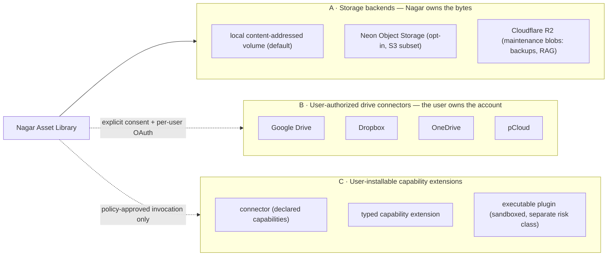

# Data, Storage & Lifecycle

**Status:** Living document
**Scope:** every store the runtime touches, what owns it, how it is migrated, and how data leaves
**Verified against:** `main` @ `04469ed` (storage Wave 1, task-272)

The system uses **one logical data model with two physical backends** (SQLite for local, PostgreSQL/Neon for scale-to-zero) plus three purpose-built stores. Nothing is shared by accident: each store has exactly one owner module.

---

## 1. Store map

```mermaid
flowchart LR
    subgraph appdb["Application DB (SQLModel + Alembic)"]
        tables["31 tables<br/>users · messages · memory · gamification · knowledge · approvals"]
    end
    subgraph sidecar["Queue sidecar (SQLite, own DDL)"]
        q["nexus_job_queue<br/>id · job_type · idempotency_key UNIQUE · payload · status"]
    end
    subgraph ckpt["Checkpoints (LangGraph runtime)"]
        cp["checkpoints · writes (+ blobs)"]
        life["nexus_checkpoint_lifecycle (PG) / sidecar table (SQLite)"]
    end
    subgraph blobs["Blob tier"]
        r2["Cloudflare R2 (s3-compatible)<br/>DB backups · model blobs"]
        cache["local model/image cache"]
    end
    graph["Orchestration graph"] --> ckpt
    queue["Bot + workers"] --> sidecar
    features["Feature engines"] --> appdb
    reconciler["Reconciler + CLI"] --> ckpt
    maintenance["nexus maintenance backup"] --> blobs
```

| Store | Owner module | Backend | Lifetime | Notes |
|---|---|---|---|---|
| Application DB | `storage/models.py` (+ 2 tables in `features/referral.py`) | SQLite (WAL) or PostgreSQL | durable | 31 tables; the product's source of truth for user-visible history |
| Job queue | `adapters/in_process_job_queue.py` | SQLite sidecar `<db>.jobs.sqlite3` | durable, disposable | owns its table and **no** Alembic migration; payloads must pass adapter validation |
| Checkpoints | `storage/langgraph_checkpoint.py` (`get_checkpointer`) | SQLite or PostgreSQL | disposable | LangGraph runtime state only; deletion never touches messages |
| Lifecycle index | `storage/checkpoint_lifecycle*.py` | PG table `nexus_checkpoint_lifecycle` / SQLite sidecar table | durable | metadata about checkpoints: age, lineage, lock state, access |
| Vector store | `features/rag.py` (`vector_path`, `chroma_db_path`) | SQLite/Chroma on disk | rebuildable | derived from documents; safe to drop and re-ingest |
| Blob tier | `storage/providers/r2.py`, `storage/ai_storage_manager.py` | Cloudflare R2 | durable | idempotent `put`/`delete` behind `ObjectStoragePort`; **maintenance artifacts only** (backups, RAG documents) — see §7 |
| User asset blobs | `storage/object_store.py` (contract), `storage/local_object_store.py` (default), `storage/neon_object_storage.py` (opt-in) | local content-addressed volume, or Neon Object Storage | durable | immutable, content-addressed (`blobs/<2>/<sha256>`); feature-gated by `NEXUS_NEON_STORAGE_*`; see §7 |
| Creative workspace | `settings.creative_temp_dir` | local temp dir | ephemeral | `slideshow_*` workspaces; stale ones pruned after 24 h |

## 2. Schema management

- **Alembic is the only schema authority.** The stopgap `create_all` path was retired (D7); startup either verifies head or runs the chain under a migration lock.
- Chain (5 revisions, current head `b5d8e2f4a917`):

```text
47903d282ede  initial schema
   └── f4a9c2e71b08  nexus_checkpoint_lifecycle (PostgreSQL only)
          └── 7c2f9d41e8a3  ai-memory consent columns on usermemory
                 └── e575469d90b9  nagar asset library v1 (assets/versions/links/ingests)
                        └── b5d8e2f4a917  Telegram id columns INTEGER → BIGINT (PostgreSQL only; audit A-17)  ← HEAD
```

- **Telegram identifiers are 64-bit.** Every user/chat id column uses `storage.models.TelegramId`, a named `TypeDecorator` (not a `with_variant` expression): its `impl` is `BigInteger` and `load_dialect_impl()` returns `Integer()` on SQLite and `BigInteger()` for every other dialect — BIGINT on PostgreSQL, unchanged INTEGER (rowid alias for primary keys) on SQLite. Because it is a named class the tests can compile it directly (`models.TelegramId().compile(dialect=…)`), which a `with_variant` expression would not allow. `tests/unit/test_telegram_id_width.py` keeps the ORM, the migration list and the PostgreSQL DDL in lockstep; `tests/integration/test_postgres_single_engine.py` writes a post-2021 user id and a supergroup id through both engines on the real PostgreSQL in CI.

- **URL normalisation** accepts `postgresql://`, `postgres://`, `postgresql+asyncpg://` and rejects everything else with a clear error (`storage/db.py::normalize_database_url`).
- **Legacy adoption instead of replay:** an existing, unstamped SQLite database or a pre-Alembic PostgreSQL database is *inspected, decided, then stamped* (`storage/adopt_pg.py`, `nexus adopt-pg`) — never re-created.
- **Drift is a failure, not a repair:** `storage/checkpoint_fingerprint.py` compares a live fingerprint to a golden manifest; updating goldens is human-only (`nexus checkpoints golden update --yes`, enforced by tests). The PostgreSQL golden includes the Alembic head, so every new revision is followed by a reviewed golden update (last: `b5d8e2f4a917`, fingerprint `96105e96…`).
- **Concurrency:** migrations take a lock (`storage/migrations.py::migration_lock`); concurrent first-run migrations are covered by `tests/integration/test_migrate_race_condition.py` and the CI `migrate-postgres` job (real `pgvector/pgvector:pg16`), which also asserts the stamp equals the head revision and that a second `nexus migrate` is a no-op.

## 3. Entity ownership (naming discipline)

SQLModel classes are the schema; product names are the contract.

| Aggregate | Table(s) | Owner |
|---|---|---|
| User / chat history | `user`, `chat`, `message` | `features/ai_chat.py`, `storage/models.py` |
| Memory | `usermemory` (+ `ai_memory_consent*`), `useractiveagent`, `documentchunk`, `knowledgecache` | `features/ai_memory.py`, `knowledge/` |
| Community | `referral`, `referralcode`, `userreputation`, `userxp`, `quizzescore`, `anonsession` | `features/{referral,gamification,anonymous_chat}.py` |
| Governance | `adminlog`, `forcejoinconfig`, `moderationconfig`, `pendingapproval`, `personalityconfig`, `engagementconfig` | `features/{owner_control,force_join,moderation,personality,engagement}.py` |
| Growth | `viralpost`, `adcampaign`, `analyticsevent`, `channelschedule`, `welcomemessage` | `features/{viral_engine,ads,analytics,channel_manager}.py` |
| Ops | `task`, `toolrun`, `reminder`, `cloudfile`, `userlanguage` | `storage/models.py`, `worker.py`, `tools/` |

## 4. Checkpoint lifecycle and deletion

| Concept | Rule |
|---|---|
| Source of truth for history | **messages** — never deleted by checkpoint cleanup |
| Workflow state | checkpoints — disposable, used only to resume |
| Deletion unit (v1) | the **whole thread**, through the native checkpointer operation, with an idempotency key |
| Per-checkpoint deletion | `POST_V1` — delta-chain surgery is unsafe; blocked by a marker constant + liveness test |
| Unknown anything | unknown lineage, schema, metadata, or lock state ⇒ **no delete** |
| Read paths | `inspect` is read-only and never updates access timestamps |
| Retention | 30-day resumability window; expired resume forks a new thread from message history |
| Circuit breaker | a cleanup run stops at **≥1 %** failed/blocked operations **or ≥500** such operations, records a redacted reason, and requires a reviewed retry |

Full policy text: [`DATA_LIFECYCLE.md`](DATA_LIFECYCLE.md), [`RETENTION_DECISION.md`](RETENTION_DECISION.md); implementation: `storage/checkpoint_reconciler.py`, `domain/policies/{retention,reconciler_policy,lifecycle_health}.py`.

## 5. Portability and backup

- **Local → Neon**: point `NEXUS_DATABASE_URL` at Neon and run `nexus migrate`; the same chain, the same head, the same fingerprint checks. `docs/ops/NEON_LIFECYCLE_RUNBOOK.md` covers keep-alive and lifecycle specifics.
- **Backups**: `nexus maintenance backup` writes to the R2 tier behind `ObjectStoragePort` (idempotency keys make repeated runs safe). Restore procedure and rotation: [`../ops/DEPLOY_RUNBOOK.md`](../ops/DEPLOY_RUNBOOK.md).
- **Ephemeral-disk rule**: in webhook/scale-to-zero mode, anything that must survive a redeploy lives in Postgres or R2 — never on local disk. The queue survives restarts because it is a SQLite sidecar on durable storage, and `nexus jobs resume` re-schedules *pending-only* work.

## 6. What never enters a store

- No credentials, tokens, or raw prompts in the operation journal or lifecycle metadata (redacted error codes only).
- No PII in dashboard responses (`api/dashboard.py`, `tests/unit/test_dashboard_privacy.py`).
- No user prompt egress to a training-capable free endpoint unless the strict-privacy flag is off and the user consented (`features/ai_memory.py` consent gate + `LLM_PROVIDERS.md`).
- No manifest, tone template, or pack resource may contain an executable key (§[`CREATIVE_STUDIO.md`](CREATIVE_STUDIO.md) §3).

---

## 7. Three storage products, not one (Wave 1, task-272)

Nagar needs three things that look similar and must never be conflated. The
distinction is a security boundary, a capacity-accounting boundary and a
support boundary at the same time.



| Layer | Who owns the data | Implemented today | Evidence level |
|---|---|---|---|
| **A. Storage backends** | Nagar (the deployment) | `ObjectStore` contract; local content-addressed adapter; Neon Object Storage adapter | contract + both adapters **VERIFIED by offline tests**; Neon live round-trip **BLOCKED** (no credential in this environment) |
| **B. Drive connectors** | the end user's own account | **nothing per-user.** `storage/unified_cloud.py` holds *static* Dropbox/pCloud/Internxt tokens for one shared account, and Google Drive only through a pre-configured `rclone` remote | **NOT IMPLEMENTED** as a per-user connection (Wave 4) |
| **C. Capability extensions** | third parties | capability packs exist (`creative/packs/**`, Ed25519 trust root, ADR 0006); no install/catalogue UX, no third-party executable plugin runtime | packs **VERIFIED**; user-installable extensions **NOT IMPLEMENTED** (Wave 6) |

### 7.1 The contract (`src/nexus_ai_agent/storage/object_store.py`)

A narrow, provider-neutral seam for **immutable content-addressed blobs**:

| Operation | Contract | Why it is in the contract |
|---|---|---|
| `put_stream(source, max_bytes, content_type, expected_sha256, metadata)` | streams in, measures SHA-256, publishes, returns `PutResult(key, sha256, size, created)` | `max_bytes` is enforced *while reading*; `expected_sha256` pins an identity the caller already measured |
| `open_bytes` / `iter_chunks` | bounded read / streaming read with end-of-stream digest check | a tampered object raises instead of being served |
| `head` / `exists` | measured identity, not a cached claim | lets a retry decide "same bytes already there" without downloading |
| `delete` | `DeleteResult(existed, soft, reclaimed_bytes)` | a soft delete must not be reported as reclaimed capacity |
| `list_keys` | prefixed, bounded listing | measurement of *our* namespace |
| `capacity` | `CapacityReport` | see §7.3 |
| `capabilities` | `BackendCapabilities` | no caller may assume multipart, presign or hard delete |

Errors are typed (`BackendNotConfigured`, `ObjectNotFound`, `ObjectTooLarge`,
`IntegrityMismatch`, `ObjectConflict`, `AuthorizationDenied`,
`TransientBackendError`, `BackendUnavailable`, `UnsupportedOperation`,
`InvalidObjectKey`) so a failure disables exactly one backend and never the
process.

**Why a third seam was necessary.** `storage/providers/base.py::StorageProvider`
is a path-based maintenance seam with no checksum, idempotency or capacity
semantics; `creative/assets/ports.py::BlobStore` is a *staging* contract
(`new_staging_key` → `stage_to` → `store`) shaped by the local filesystem. A
remote store cannot implement the staging dance honestly. The new contract does
not replace either: R2 keeps its backup/RAG routing untouched, and the Asset
Library's ingest path keeps its staging seam until Wave 2 refactors the split.

### 7.2 Backends: what exists, and what each one truly is

| Backend | What it is | Status | Notes |
|---|---|---|---|
| Local content-addressed | `LocalObjectStore` over the existing `LocalContentAddressedBlobStore` + `WorkspaceFilesystem` | **implemented, offline-tested** | the *only* filesystem security layer; no delete (blobs are shared), no metadata sidecar — both declared in `capabilities()` |
| Neon Object Storage | `NeonObjectStorage` over the branch S3 endpoint | **adapter implemented, offline-tested; live round-trip BLOCKED** | beta; path-style + SigV4 only; `DeleteObject` is a **soft** delete; versioning/lifecycle stored-but-unenforced; no quota API |
| Cloudflare R2 | existing technical blob tier | **unchanged by this wave** | user-asset use is Wave 2 and needs a *separate* bucket/credential pair, never the backup configuration |
| Google Drive / Dropbox / OneDrive / pCloud | *connectors*, not backends | **not implemented per-user** | see §7.4 |

The Neon endpoint is validated, not trusted: `NeonStorageConfig` refuses a
non-`https` endpoint, refuses a host outside `*.neon.tech` (pointing at AWS S3
is a documented Neon failure mode), and refuses an invalid bucket name. The
adapter sets `endpoint_url`, `region_name`, path-style addressing, SigV4 and
`request_checksum_calculation="when_required"`, and disables botocore's own
retry loop so exactly one bounded retry policy exists.

### 7.3 Capacity must be truthful (the rule this section exists for)

`CapacityReport` requires a **source** and a timezone-aware **`measured_at`**,
and carries one of three provenances:

| Kind | Meaning | Exposed as "available"? |
|---|---|---|
| `AUTHORITATIVE` | a provider quota/usage API answered for this account | yes — and only when both quota and usage are present |
| `ADVERTISED` | a plan allowance published by the provider | **no** (`verified_remaining_bytes` stays `None`) |
| `UNKNOWN` | no dependable figure exists | **no** — and the type *rejects* carrying quota/used numbers |

Rules that follow from it:

- **Never sum advertised plans.** "15 GB + 2 GB + 10 GB" is not capacity; the
  previous `PROVIDER_LIMITS` / `TOTAL_FREE_GB` table in
  `storage/unified_cloud.py` is exactly that anti-pattern and is not used by
  this layer.
- **Unique bytes ≠ replicated bytes.** `CapacityReport` keeps
  `measured_unique_bytes` and `replicated_bytes` apart; a backup copy is not
  new capacity.
- **Database capacity is not object capacity.** Neon PostgreSQL storage and
  Neon Object Storage are separate products with separate limits.
- **Deletion is not reclamation** when the provider soft-deletes (Neon). The
  report says so in `note`, and `DeleteResult.reclaimed_bytes` stays `0`.
- **A failed or revoked credential is zero capacity, not "available".** The
  backend is reported unavailable; nothing is silently re-routed.

### 7.4 User-authorized drive connectors (Wave 4 — not started)

Target: the user connects **their own** Google Drive / Dropbox / OneDrive /
pCloud account. That requires a per-user OAuth lifecycle (state/CSRF, code
exchange, encrypted refresh token, rotation, revocation, disconnect), durable
ownership by Principal **and** workspace/project, and least-privilege scopes.

Today's code is not that, and must not be described as it:

- `unified_cloud._DropboxProvider` / `_PcloudProvider` / `_InternxtProvider`
  take a **static** bearer token from the environment: one shared identity for
  every user of the deployment.
- `_PcloudProvider.get_usage()` returns a hard-coded 10 GB allocation and
  `used_bytes: 0`; `_InternxtProvider` returns the same shape. Those are
  fabricated measurements, not observations.
- Google Drive is reachable only through a pre-configured `rclone` remote
  (`RcloneProvider`) — a deployment-wide CLI credential, with no OAuth
  callback, no consent screen and no per-user state.
- OneDrive is absent from the tree entirely.

A per-user connection is **not** an S3 bucket and needs its own provider-specific
adapter, quota semantics and error surface. Wave 4 also depends on durable
identity ownership: the reference `PrincipalDirectory` is in-memory today (open
PR #243), so a per-process map cannot be the ownership authority for a
persistent connection.

### 7.5 User-installable capability extensions (Wave 6 — not started)

Three distinct things, three distinct risk classes:

1. **Connector** — a described external service (auth + scoped API access).
2. **Typed capability extension** — declared operations with typed inputs and
   outputs, executed by NEXUS under its existing policy.
3. **Executable third-party plugin** — code. An OAuth grant must never imply
   permission to run code; plugins need versioning, signature/trust
   verification, declared permissions, isolation (separate process), resource
   limits, uninstall and rollback.

Invocation stays behind the existing `CommandBus` / capability / policy
pipeline; no extension gets its own execution path.

### 7.6 Explicit non-goals

- No "unlimited" or "guaranteed multi-terabyte" capacity claim, and no summing
  of free tiers.
- No account multiplication, quota evasion, or test-account farming.
- No silent deletion, eviction or orphaning when a quota is exhausted or a token
  is revoked.
- No Neon **Auth** replacing the Principal model merely because Neon provides
  storage.
- No third-party executable code inside the trusted NEXUS process.

### 7.7 Staged roadmap and current status

| Wave | Scope | Status |
|---|---|---|
| 0 | live audit; three-layer architecture; capacity policy; non-goals | **done in this page** (dedicated page deferred: `docs/README.md` is leased by PR #240) |
| 1 | typed contract + local adapter + Neon adapter + tests | **this wave** — offline-verified, live round-trip blocked |
| 2 | R2 as a *separate* user-asset backend | queued; must not disturb backup/RAG routing |
| 3 | registry, health, quota, placement/fallback policy, per-asset location | queued; needs authoritative quota sources |
| 4 | per-user OAuth drives (smallest slice first) | queued; blocked on durable identity ownership (PR #243 is still a reference in-memory directory) |
| 5 | Connections UI/API + connector manifests | queued; blocked on Wave 4 |
| 6 | trusted extension catalogue | queued; blocked on Waves 3–5 |

Enforcing tests for every law in this section: `tests/architecture/test_storage_backend_boundary.py`
(R22 in [`MODULE_MAP.md`](MODULE_MAP.md) §3).
