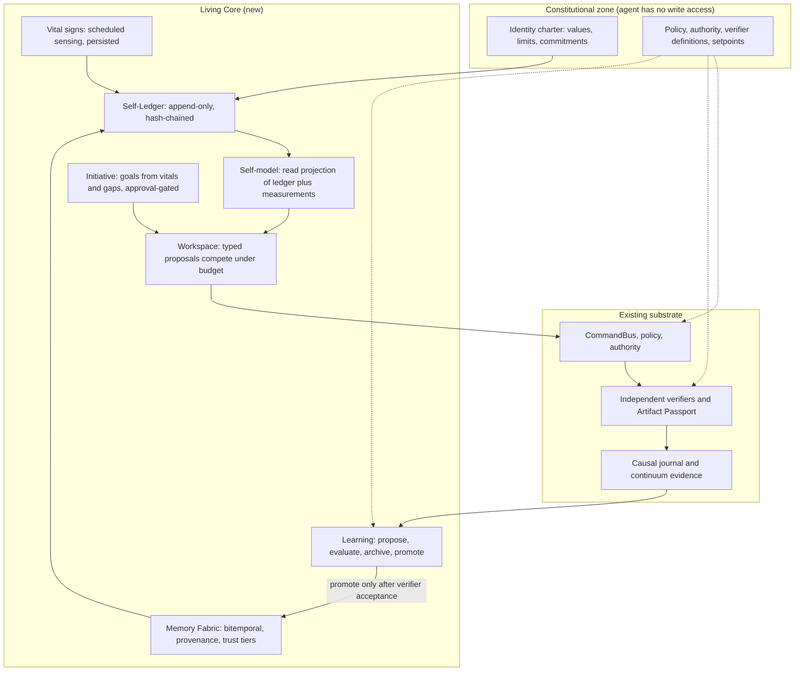

# Living Intelligence Roadmap — NEXUS × Nagar

**Status:** Proposed direction (owner review required) · **Written:** 2026-10-18 · **Repo baseline:** `main` at `62922df` (verify with `git log origin/main`; the head moves daily)
**Persian summary:** [LIVING_INTELLIGENCE_ROADMAP.fa.md](LIVING_INTELLIGENCE_ROADMAP.fa.md) (English wins on conflict)
**Builds on:** [CREATIVE_DIRECTION.md](CREATIVE_DIRECTION.md) (D-0025, the intent-first loop), [PROVENANCE_LEDGER.md](PROVENANCE_LEDGER.md) (D-0024, evidence never authority), [TRUST_CONTROL_PLANE.md](TRUST_CONTROL_PLANE.md), [SECURITY.md](SECURITY.md).

## 1. The thesis in one paragraph

The owner's request is to make the project itself behave like a living, capable intelligence instead of bolting another model onto it. This roadmap reads that as an engineering target with a measurable definition: **a system that persists as the same entity across restarts, senses its own condition, acts on goals it can justify, checks its own work with instruments it does not control, and improves only through changes that an independent verifier accepts.** Every one of those properties can be built and tested on the substrate this repository already has. Whether such a system is *conscious* cannot be verified by current science (see §3), so no product text may claim it.

The design rule that follows from the evidence: **the model is a replaceable faculty; identity, memory, drives and judgment live in durable, auditable state outside it.** This is already the direction of Nagar (`nagar/cognition`: "the model-optional reasoning seam"). This roadmap extends it from *one creative request* to *a continuing life of the system*.

## 2. What exists today (verified against `62922df`, read-only)

| Capability | Where | Honest state |
|---|---|---|
| Single write path with policy and authority | `creative/studio/` CommandBus | Implemented, mutation-tested |
| Hash-chained causal journal + fail-closed Artifact Passport | `provenance/` (`journal.py`, `passport.py`) | Implemented; evidence only, never authority |
| Evidence contracts as CI gates (95% per pack, snapshot verifier, mutation campaigns, run twice and `cmp`) | `continuum/`, `.github/workflows/ci.yml` | Implemented |
| Intent → creative graph → compiler → bus → artifact + lineage | `creative/spine/` | In-memory, single project |
| Model-optional proposal contract (typed, refusable, provenance-carrying) | `nagar/cognition/` | Implemented, additive |
| Exact temporal primitives (timebase, intervals, clock relations) | `creative/temporal/` | Implemented, stdlib only |
| Content-addressed asset library | `creative/assets/` | Implemented (merged lineage via task-266) |
| Checkpoint lifecycle store + reconciler | `storage/checkpoint_*`, `adapters/langgraph/` | Implemented |
| Human approval gate | `agent/approval.py` | Persists requests; `auto_apply_at` is stored but never acted on |

**Structural gaps that this roadmap targets** (each is a file-level fact, not an opinion):

1. `agent/self_monitor.py` is only called on demand (`bot/monitor_handlers.py`, `bot/update_handlers.py`); nothing schedules it, nothing persists its readings, and `auto_fix` for a database issue is `pass`.
2. `memory/long_term.py` stores `memories(id, thread_id, content, embedding)` and discards the `metadata` argument (`_ = metadata`). There is no timestamp, source, validity window, confidence, supersession or deletion path.
3. `orchestration/state.py` `NexusState` has no self-model, goal, confidence or evidence fields; the graph in `orchestration/graph.py` is a single forward pass (router → memory → planner/persona → moderation → memory writer) with no critic or verifier node.
4. Provider health (cooldown, fallback ratio) lives in `litellm.Router` and process-local counters; it is lost on restart.
5. `agent/updater.py` pulls and installs after approval but runs no post-update verification and has no rollback.
6. The intent router is keyword-based (EN + FA), so the system cannot yet say how confident it is about what the user wanted.
7. Nothing measures continuity, calibration, or whether the system's statements about itself match its logs.

## 3. Evidence that shaped the design (and its limits)

All items were fetched on 2026-10-18; most reads were abstract-level. Numbers are the authors' own and benchmark-specific.

| Finding | Source | Design consequence |
|---|---|---|
| Layered memory plus reflection plus planning each measurably help; removing observation (memory) hurts most. Reported failure modes: retrieval failure, embellishment, over-agreeableness shifting character, degradation as memory grows | Generative Agents, [arXiv 2304.03442](https://arxiv.org/abs/2304.03442) | Memory is the first investment; reflections are untrusted until verified |
| LLM introspection is narrow and unreliable (about 20% best-case detection of injected concepts; failures "remain the norm"); experience-style self-reports can be induced by prompting | Lindsey 2025 ([Transformer Circuits](https://transformer-circuits.pub/2025/introspection/index.html)); Berg et al. [arXiv 2510.24797](https://arxiv.org/abs/2510.24797) | The self-model is an **external, evidence-linked record**, never the model's own account of itself |
| Prompt-level persona drifts within about eight dialog rounds | Li et al., [arXiv 2402.10962](https://arxiv.org/abs/2402.10962) | Identity is re-loaded from durable state every cycle and probed |
| Memory poisoning works at tiny poison rates and through ordinary queries | AgentPoison [arXiv 2407.12784](https://arxiv.org/abs/2407.12784); MINJA [arXiv 2503.03704](https://arxiv.org/abs/2503.03704) | Trust tiers, provenance tags, quarantine for untrusted-origin writes |
| Consensus validation across memories plus a separate lessons memory cut attack success by over 95% (self-reported) | A-MemGuard [arXiv 2510.02373](https://arxiv.org/abs/2510.02373) | Require agreement before acting on a retrieved precedent |
| Governing evolving memory: provenance, consistency checks, decay, gating before consolidation (a proposal with formal analysis, no experiments in the abstract) | SSGM [arXiv 2603.11768](https://arxiv.org/abs/2603.11768) | Consolidation ("sleep") is a gated job, separate from task execution |
| Bi-temporal facts, invalidation instead of deletion, lineage back to source episodes | Graphiti README / Zep [arXiv 2501.13956](https://arxiv.org/abs/2501.13956) | Memory v2 schema (§5, Phase 3). Backends are graph databases; a SQL version is our re-implementation, not a verified product |
| Every self-improvement result that works gates a change on an executable evaluator and keeps an archive; gains are measured on the same benchmark family used as fitness | Darwin Gödel Machine [arXiv 2505.22954](https://arxiv.org/abs/2505.22954); SICA [arXiv 2504.15228](https://arxiv.org/abs/2504.15228); ACE [arXiv 2510.04618](https://arxiv.org/abs/2510.04618) | Learning = propose → independent evaluate → archive → promote; evaluator and policy are outside the learner's write access |
| Offline "sleep-time" computation can cut test-time compute about 5x on modified benchmarks | Sleep-time Compute [arXiv 2504.13171](https://arxiv.org/abs/2504.13171) | Consolidation windows are worth building; expect task-dependent gains |
| A plain file plus tools reportedly matches structured memory on LoCoMo (vendor claim); LoCoMo is short | Letta blog; LoCoMo [arXiv 2402.17753](https://arxiv.org/abs/2402.17753) | Evaluate memory on knowledge-update, abstention and forgetting (LongMemEval [arXiv 2410.10813](https://arxiv.org/abs/2410.10813), MemoryAgentBench [arXiv 2507.05257](https://arxiv.org/abs/2507.05257)), not LoCoMo alone |
| Best media agents solve about 31% (paper) to 38% (later leaderboard) of professional post-production tasks vs 88.5% for human experts; they fail on long-context loss and temporal reasoning | AgenticVBench [arXiv 2605.27705](https://arxiv.org/abs/2605.27705) | Independent programmatic verifiers are the core product, not a feature |
| Best of 16 agents solves 26.8% (15/56) of timeline edits; agents claim full success in 93% of runs and in 95.5% of edits that actually fail; most unresolved runs fail only the quality test | Timeline-Bench [arXiv 2609.35143](https://arxiv.org/abs/2609.35143) | The **claim-vs-measured gap** is a first-class health metric |
| Consciousness: indicator properties are derivable from theories; "no current AI systems are conscious"; guidance to convey uncertainty rather than confident claims either way | Butlin et al. [arXiv 2308.08708](https://arxiv.org/abs/2308.08708); Long et al. [arXiv 2411.00986](https://arxiv.org/abs/2411.00986) | Honest wording rules (§7) |

**Limits of this evidence.** The 2026 "Global Workspace Agents" proposal ([arXiv 2604.08206](https://arxiv.org/abs/2604.08206)) reports no quantitative results in the retrieved abstract, so the workspace in Phase 5 is justified as an engineering blackboard, not as an empirically proven component. No peer-reviewed "aliveness" benchmark was found; the metrics in §6 are this document's proposals and must be validated. I did not verify whether any published system combines all the pieces below; the novelty claim in §9 is therefore a claim about integration, stated with that caveat.

## 4. Target architecture: the Living Core

The Living Core is **not a new brain**. It is a set of durable, auditable loops over the existing substrate. Nothing in it executes, authorizes or mutates state on its own authority; every action still goes through the CommandBus and Policy.



| Layer | Role | Rule it enforces |
|---|---|---|
| Constitutional zone | Charter, policy, verifier definitions, health setpoints | Read-only to every learning, memory and initiative component; changed only by a human-approved PR |
| Self-Ledger | Append-only record of identity, commitments, vitals, memory writes, promotions | Reuses the hash-chain pattern of `provenance/journal.py`; evidence, never authority |
| Self-model | Projection: what the system can do (with measured reliability), its current health, open commitments, known limits | Computed from ledger and measurements; the LLM only reads it |
| Vital signs | Scheduled interoception: provider health, queue lag, verification failure rate, backup freshness, memory integrity canaries, budget | Computed outside the agent's write access, so a drive cannot be satisfied by editing its own meter |
| Memory Fabric | Episodic, semantic, procedural memory with provenance and trust tiers | Untrusted-origin content is quarantined; a belief can be traced to its source episode and revoked |
| Workspace | Blackboard where typed proposals (existing `nagar.cognition` contract) compete under a budget and are broadcast | Proposals carry no authority; wording: "inspired by Global Workspace Theory" |
| Learning | Lessons and procedures change only through propose → independent evaluation → archive → promote | The evaluator is a regression suite plus replay of past intents, never the model itself |
| Initiative | Goals generated from vital-sign deviations and verified gaps | Subject to the approval ladder, budgets and rate limits; usefulness is measured |

## 5. Phased roadmap

Phases are ordered by dependency, not by calendar. **No percentage of completion is claimed anywhere**; a phase is done only when its exit evidence is reproducible from the tree and CI. Each phase is delivered as small PRs through the claim board (`AGENTS.md`), with a failing-first test per behavior.

### Phase 0 — Delivery truth and stability (prerequisite)

- **Goal:** one trustworthy `main`. Land the remaining remediation layers (P2 route inventory and the layers after it) from current `main`; decide the fate of the 305-file conflicted PR #218 (rebuild in layers from `main` vs rebase; owner decision). Set the five production backup secrets so the nightly `maintenance` workflow stops failing closed (`NEXUS_DATABASE_URL`, `R2_ACCOUNT_ID`, `R2_ACCESS_KEY_ID`, `R2_SECRET_ACCESS_KEY`, `R2_BUCKET`).
- **Exit evidence:** full CI green on the exact `main` SHA; a restore drill from a real backup recorded as evidence; zero open PRs older than 14 days without a recorded decision.
- **Risks:** merge conflicts at scale; mitigated by layered PRs and the board referee.

### Phase 1 — Charter and Self-Ledger (identity that persists)

- **Deliverables:** `docs/architecture` charter page (values, hard limits, commitments); `selfhood/ledger.py` reusing the journal's canonical-JSON hash chain; boot sequence that loads the charter and verifies the chain before serving; signed charter version bumps via PR only.
- **Acceptance:** after kill and restart the system restores 100% of charter entries and open commitments (test with injected crashes); a tampered ledger record makes boot refuse to serve (fail closed); the agent has no code path that writes the charter (architecture test, in the style of `tests/architecture/test_spine_boundary.py`).
- **Trade-off:** extra boot latency vs a provable identity. Accepted; verification is a hash walk over a small chain.

### Phase 2 — Vital signs (interoception)

- **Deliverables:** a scheduler (none exists today); persisted provider health and fallback ratio; scheduled `SelfMonitor` with history; setpoints in the constitutional zone; real `auto_fix` actions that are *proposals through the bus*, not direct calls; updater gets post-update verification and rollback.
- **Acceptance:** vitals survive restart; a simulated provider outage appears in the ledger within one schedule period; an updater that fails verification rolls back (integration test); `auto_apply_at` is either implemented with a test or removed.
- **Risk:** metric gaming. Mitigation: meters are computed by code the learner cannot edit.

### Phase 3 — Memory Fabric v2

- **Deliverables:** migration adding `memory_episodes(id, source, trust_tier, content_hash, recorded_at)` and `memory_facts(id, subject, predicate, object, valid_from, valid_to, recorded_at, retracted_at, source_episode_id, confidence, author)`; retrieval that is time-aware; revocation cascade (retract an episode → retract facts supported only by it); quarantine tier for content that came from untrusted channels (forwarded messages, documents, web pages); poison canaries in CI. The design follows the Graphiti lineage model; the SQL schema is this document's proposal.
- **Acceptance:** a committed eval of knowledge-update, abstention and forgetting cases (style of LongMemEval / MemoryAgentBench; the existing `memory/eval.py` recall@k baseline stays as the floor); an injected poisoned record is never used for a privileged action (test); revoking a source removes its derived facts (test).
- **Risk:** metadata bloat and migration risk on a live database. Mitigation: additive Alembic migration, dual-write period, golden-schema test.

### Phase 4 — Verifier-in-the-loop on one vertical slice

- **Deliverables:** one real Nagar workflow end to end (the owner chooses which; see §8), with programmatic verifiers first (ffprobe duration and streams, loudness, scene-cut and frozen-frame checks, speech-to-text accuracy) and rubric/LLM judges only where no programmatic test exists; the Artifact Passport records measured results; a **claim-vs-measured gap** metric (how often the system said "done" while a verifier failed).
- **Acceptance:** a committed benchmark of at least 30 reproducible cases with a published pass rate (no target number is promised in advance); claim gap reported per release; a judge never grades its own generator's output.
- **Risk:** LLM-judge bias (position, verbosity, self-preference; Zheng et al. [arXiv 2306.05685](https://arxiv.org/abs/2306.05685)). Mitigation: programmatic checks dominate; judges are majority-of-three and calibrated against human labels.

### Phase 5 — Workspace and initiative

- **Deliverables:** blackboard where `nagar.cognition` proposals compete under a token/time budget; goal proposals derived from vital-sign deviations and verified gaps (for example "backup older than N hours", "verification failures clustering on one operation"); every proposal passes the approval ladder.
- **Acceptance:** with no model available the system still produces deterministic goal proposals (model-optional is preserved); autonomy-usefulness metric defined and logged; a rate limit and a kill switch tested.
- **Trade-off:** more autonomy vs more risk. Accepted only behind the approval ladder with measured usefulness.

### Phase 6 — Consolidation and learning

- **Deliverables:** a scheduled "sleep" job that clusters episodes into candidate lessons and candidate procedures; promotion only after the independent evaluator (regression suite plus replay of past intents) accepts and the confidence/consensus rule passes; an archive of rejected candidates; lessons stored separately from facts.
- **Acceptance:** an ablation (memory off, lessons off) shows the measured lift on the Phase 4 benchmark; a candidate that edits the verifier, policy or charter is rejected by construction (test); no promotion without a ledger entry.
- **Risk:** the Darwin-Gödel-style benchmark-overfitting problem. Mitigation: hold-out cases never visible to the learner.

### Phase 7 — Web Studio and explanation surfaces

- **Deliverables:** UI over the real API; every artifact shows its passport, every statement the system makes about itself links to ledger evidence; no parallel source of truth in the UI.
- **Acceptance:** an end-to-end browser test that follows "why did you do this?" from UI to ledger entry.

### Phase 8 — Temporal media intelligence and creative history

- **Deliverables:** timestamp-indexed media understanding, dependency DAG with content-addressed cache and partial rerun, event-sourced edit history (creative undo, branch and compare).
- **Acceptance:** editing one clip reruns only dependent nodes (test with a counted-execution fake); undo restores the byte-identical prior artifact.
- **Note on novelty:** partial rerun and event-sourced histories have broad prior art in build systems and creative tools. Do not market them as inventions; the value is their integration with the passport and the verifier.

### Phase 9 — Production hardening

- **Deliverables:** egress allowlist and per-provider data-class policy; replaceable providers behind ports; restore drills on a schedule; load and soak tests; threat model update for memory-bearing agents.
- **Acceptance:** a game-day (provider outage, database failover, poisoned memory) with a written result.

## 6. How "aliveness" is measured (proposed metrics, to be validated)

| Property | Metric | Test |
|---|---|---|
| Continuity | Fraction of charter entries and open commitments restored after K restarts; persona-probe consistency across N cycles | Crash-injection test; probe suite |
| Self-knowledge validity | Agreement between what the system says about itself and the ledger | Automated audit of self-descriptions vs ledger |
| Calibration | Expected calibration error of stated confidence vs verified outcomes | Verified-outcome table from Phase 4 |
| Claim gap | Share of "done" claims contradicted by a verifier | Per-release report |
| Memory integrity | Poison-canary survival rate; revoked-fact leakage rate | CI canaries |
| Adaptation | Benchmark lift from lessons/procedures with memory-off control | Ablation run |
| Autonomy value | Share of self-initiated goals later judged useful and within policy | Approval log review |
| Drift | Persona-probe distance over time | Scheduled probe |

## 7. Honest-claims policy

Allowed: "persistent, memory-based agent that keeps a verified identity and commitment record across restarts, measures itself, and improves only through independently verified changes." Not allowed in product text: "conscious", "sentient", "aware" in the experiential sense, "feels", "alive". A workspace is described as "inspired by Global Workspace Theory". When inner-state questions are asked the system answers from its ledger and says that subjective experience cannot currently be verified. This follows the uncertainty guidance in [arXiv 2411.00986](https://arxiv.org/abs/2411.00986).

## 8. Open decisions for the owner

| # | Decision | Default if unanswered |
|---|---|---|
| 1 | Which single Nagar workflow is the Phase 4 vertical slice | The existing slideshow pack, because its render lane and verification already exist |
| 2 | Monthly budget and egress limits for cloud models | Local-first (Ollama), cloud only for named data classes |
| 3 | Fate of PR #218 (rebuild in layers vs rebase) | Rebuild in layers from `main` |
| 4 | Approval level for self-initiated goals | Every self-initiated goal needs human approval until the autonomy-value metric exists |
| 5 | Language of the system's self-descriptions | Persian first, English fallback |

## 9. Decision record

```json
{
  "decision_record": {
    "title": "Adopt the Living Core: durable, auditable self-state around a replaceable model",
    "context": "Nexus has strong evidence and execution substrates (causal journal, Artifact Passport, continuum gates, intent spine, model-optional cognition seam) but no persisted self-state, no provenance on memory, no scheduled self-sensing, and no measurement of whether it does what it says. Published evidence shows introspection is unreliable, memory is poisonable, and self-improvement works only when gated by an external evaluator.",
    "decision": "Build identity, vital signs, memory, workspace, learning and initiative as ledger-anchored layers that sit outside the model and outside the learner's write access, delivered in the phases of this document, each with reproducible exit evidence. Keep the constitutional zone (charter, policy, verifiers, setpoints) human-controlled.",
    "consequences": "More durable state and more migrations; slower first demo than adding a model; in return the system can prove who it is, what it did and how reliable it is. Consciousness is explicitly not claimed. Proposed log entry: D-0029 (to be recorded in DECISION_LOG.md after owner acceptance)."
  },
  "alternatives_considered": [
    "Add a stronger or additional LLM: rejected, it improves one faculty and leaves identity, memory integrity and verification unsolved.",
    "Adopt a third-party memory product wholesale: deferred; verified products are graph-database based and vendor-benchmarked, so a SQL bitemporal schema is the lower-coupling path.",
    "Let the agent rewrite its own policy or verifier: rejected, no verified self-improvement result works without an external evaluator."
  ],
  "novelty_claim": "Each component has prior art. The proposed contribution is the integration: a hash-chained self-ledger, a self-model computed from measurements rather than introspection, drives computed outside the agent's write access, and learning promoted only by independent verifiers, all in a model-optional substrate with published aliveness metrics. Whether a published system already combines all of these was not verified."
}
```

## 10. Validation of this document

Facts in §2 come from `git show 62922df:<path>` on 2026-10-18. Literature in §3 was fetched the same day, mostly at abstract level; full-text details were not read. The two media benchmarks were confirmed to exist and to contain the numbers quoted. Proposed schemas, phases and metrics are design proposals, not results.
