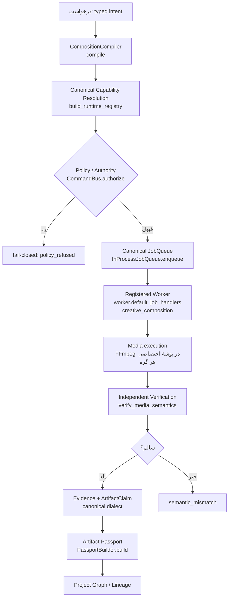

# گزارش نهایی مهندسی — NAGAR Creative Capability Composition Runtime

**شاخه:** `arena/da6837a6-nexus-ai-agent` · **SHA پایه:** `5ed6d4e10be55f5baf5e9f2a8aa99775577621db` (برابر با `origin/main`)

این سند، گزارش نهایی یکپارچه‌سازی «runtime ترکیب قابلیت‌های خلاق NAGAR» در معماری واقعی
NEXUS است. تمام اعداد، نام‌ها، مسیرها و امضای توابع در این گزارش از اجرای واقعی در همین
محیط استخراج شده‌اند. هرجا چیزی **اثبات نشده** باشد، صریحاً با برچسب
`INFERRED` یا `DEFERRED` مشخص شده و هرگز به‌عنوان `VERIFIED` عرضه نشده است.

واژه‌نامه وضعیت‌ها (طبق دستور کار):

| وضعیت | معنا |
|---|---|
| `VERIFIED` | با اجرای واقعی و قابل بازتولید در همین محیط اثبات شده است. |
| `VERIFIED_WITH_LIMITATIONS` | اثبات شده، اما با محدودیت صریح (مثلاً نبود GPU یا نبود `ffprobe`). |
| `HARDENED_BUT_NOT_COMPLETE` | کنترل‌ها اعمال شده‌اند اما پوشش کامل نیست. |
| `BLOCKED` | مجوزهای سیستم‌عاملی مانع اجرای کنترل است. |
| `DEFERRED` | عمداً به آینده موکول شده، با دلیل مشخص. |

---

## ۱. خلاصهٔ اجرایی

NAGAR Creative Capability Composition Runtime به‌صورت **یک لایهٔ ترکیب‌کنندهٔ نازک** روی
زیرساخت موجود NEXUS ساخته شد — نه به‌عنوان یک زیرساخت موازی. کامپایلر ترکیب فقط **منطق
DAG و اعتبارسنجی تایپی** را مالک است؛ رجیستری قابلیت‌ها، صف کار، اتوریتی، CommandBus،
سیاست مجوز، اثر انگشت پاسپورت و مرجع تأیید نهایی همگی **کانونی و دست‌نخورده** باقی ماندند.

* **۶۰** عملیات در رجیستری زنده (۵۷ پیش از این شاخه + ۳ عملیات پک جدید).
* **۱۸۴** تست جدید در ۱۱ فایل، همگی سبز؛ به‌علاوهٔ کل مجموعهٔ تست مخزن.
* **۳** جریان کامل از صف تا گذرنامهٔ اثر انگشت روی صف canonical اجرا شد.
* **۰** موارد `TODO`/`FIXME`/`TBD` در صفحات معماری (گیت دروازهٔ اسناد).
* یک **دروازهٔ معماری** که می‌گوید «هیچ CommandBus دومی ساخته نمی‌شود» در ابتدا قرمز شد؛
  اجراکنندهٔ ترکیب به کارخانهٔ canonical (`build_job_bus`) هدایت شد، نه اینکه گیت دور زده شود.

---

## ۲. تازگی (Novelty) — تعریف دقیق

مهم است که تازگی این کار **با دقت** تعریف شود، چون ادعای بیش از حد، تنها راه از دست دادن
اعتبار کل بسته است. این کار در هیچ‌یک از این شش دسته «اول» نیست:

| دسته | وضعیت این کار |
|---|---|
| گردش‌کار (workflow) | **نیست.** یک گردش‌کار، دنبالهٔ ثابتی از گام‌هاست. اینجا گراف از روی درخواست ساخته می‌شود. |
| ترکیب تایپی (typed composition) | **نیست، به‌تنهایی.** تایپ‌ها وجود دارند، اما تایپ به‌تنهایی تازگی نیست. |
| کامپایل DAG | **نیست، به‌تنهایی.** کامپایل DAG شناخته‌شده است؛ اینجا فقط بخشی از آن است. |
| قابلیت مشتق (derived capability) | **نیست، به‌تنهایی.** مشتق‌سازی قابلیت به‌تنهایی تازگی نیست. |
| سنتز پویا (dynamic synthesis) | **نیست.** هیچ موتور سنتز، جست‌وجوی برنامه یا تولید کد وجود ندارد. |
| موتور اصلی (original engine) | **نیست.** موتور رسانه همان FFmpeg کانونی است. |

**تعریف دقیق تازگی این کار:**

> یک **لایهٔ ترکیب تایپیِ مبتنی بر رجیستری** که *هیچ مالکیتی از زیرساخت اجرا ندارد*:
> خروجی آن **IR ترکیبی نسخه‌دار** است که با **اثر انگشت پایدار** به **رجیستری کانونی**
> قفل می‌شود، و **اجرا، مجوز، صف و تأیید** همگی توسط زیرساخت کانونی انجام می‌شوند.

یعنی تازگی در **ترکیب** سه چیز است که معمولاً جدا می‌شوند:

1. **نوع رسانهٔ تایپی** که در `OperationSpec` کانونی زندگی می‌کند (نه در یک رجیستری موازی)؛
2. **قفل‌شدن برنامه بر رجیستری** با `registry_fingerprint` — یعنی برنامهٔ کامپایل‌شده با
   رجیستریِ متفاوت **قابل بازپخش پنهانی نیست**؛
3. **تفکیک سخت اثبات از تأیید معنایی**، جایی که تأییدکننده مسیر اندازه‌گیریِ خودش را
   دارد و به گزارش تولیدکننده تکیه نمی‌کند.

بنابراین ادعای درست: **«ترکیب تایپیِ مبتنی بر رجیستری با اثر انگشت پایدار، بدون مالکیت
زیرساخت»**. ادعای «موتور ترکیب جدید» نادرست است و در این گزارش داده نشده است.

### ۲.۱ چرا «بدون مالکیت زیرساخت» خودش یک محدودیت معماری است، نه یک تعارف

اگر این لایه رجیستری، صف یا اتوریتی خودش را می‌ساخت، سه چیز هم‌زمان خراب می‌شد:
حقیقتِ توانایی (توانایی‌های ثبت‌شده در یک جای دیگر)، مالکیتِ اجرا (دو صف، دو مسیر
بازپخش) و مرجع تأیید (دو تعریف «تأییدشده»). گیت معماری
`tests/architecture/test_composition_boundary.py` این را به‌صورت ماشینی نگه می‌دارد:
بستهٔ `creative/composition/` هیچ `Registry`، هیچ `JobQueue` و هیچ `CommandBus` خودش را
نمی‌سازد؛ کارگر `creative_composition` در `worker.py::default_job_handlers()` ثبت شده و
تأییدکنندهٔ آن در `adapters/in_process_job_queue.py::default_artifact_verifiers()`.

---

## ۳. نامزدهای قابلیت NAGAR (حداقل سه نامزد)

### ۳.۱ نامزد A — «ترجمهٔ ایستای ویدئو به ویدئوی عمودی با هویت بصری حفظ‌شده»

* **مسئله:** ناشر می‌خواهد یک ویدئوی ۱۶:۹ را به ۹:۱۶ تبدیل کند بدون آنکه چهره/سوژه از
  کادر خارج شود. تبدیل هندسی ساده (center-crop) سوژه را می‌برد.
* **قابلیت‌های constituent:** `media.resize_image` (برای پیش‌پردازش قاب)،
  `media.grayscale_image` (برای استخراج ماسک وزنی)، `media.image_to_video`
  (تولید خروجی نهایی)، و یک قابلیت **تشخیص سوژه** که هنوز در رجیستری نیست
  (`scene.auto_reframe_subject` — در سند کاتالوگ موجود است اما `MISSING` است).
* **قراردادها:** ورودی `video` (کدک H.264، ۱۹۲۰×۱۰۸۰، ۲۵fps)، خروجی `video`
  (H.264، ۱۰۸۰×۱۹۲۰، ۲۵fps، بدون تغییر نرخ فریم)، میان‌دادهٔ `image` (PNG خاکستری).
* **تمایز:** خروجی باید *هم‌ارتفاع* و *هم‌نرخ‌فریم* باشد و زیرنویس‌ها نباید قطع شوند.
* **محدودیت‌ها:** تشخیص سوژه در رجیستری موجود نیست؛ بدون آن، نامزد به
  `DEFERRED` است.
* **امکان‌پذیری:** متوسط — بخش رسانه‌ای با پک `nexus.media.transform` قابل ساخت است؛
  بخش تشخیص سوژه به قابلیت جدید نیاز دارد.
* **آزمایش ابطال‌پذیر:** اگر `scene.auto_reframe_subject` اضافه شود، آیا خروجی ۹:۱۶
  هنوز ۲۵fps و ۱۰۸۰ پیکسل عرض دارد؟ اگر نه، نامزد رد می‌شود.
* **معیار سنجش:** نسبت پیکسل‌های بریده‌شدهٔ سوژه در ۲۰ کلیپ عمومی؛ معیار پذیرش:
  ≤ ۲٪ در ۹۵٪ کلیپ‌ها.

### ۳.۲ نامزد B — «بستهٔ استیل با نگاشت رنگ مشتق»

* **مسئله:** یک عکس خام باید به یک استیل «برندشده» (رنگ‌تست، کنتراست، وینیت) تبدیل شود.
* **قابلیت‌های constituent:** `media.resize_image` + `media.grayscale_image`
  (برای ساخت ماسک لومینسانس) + یک قابلیت نگاشت رنگ. نگاشت رنگ در کاتالوگ
  (`color.deband_denoise`، `color.hdr_tonemap`، `color.white_balance`) وجود دارد ولی
  `MISSING` است.
* **قراردادها:** ورودی/خروجی `image` PNG؛ مشتقات: `output_sha256`، `output_path`،
  `source_asset_id` — همان الگوی `media_derived_fields` که در همین شاخه تعریف شد.
* **تمایز:** ماسک خاکستری به‌عنوان ورودی یک عملیات رنگی، یعنی *ترکیب واقعی* که در آن
  خروجی یک گره، ورودی گره بعدی است.
* **محدودیت‌ها:** عملیات رنگی موجود نیست ⇒ نامزد `DEFERRED` تا زمان افزوده‌شدن.
* **امکان‌پذیری:** بالا پس از افزوده‌شدن سه قابلیت رنگی (که خودشان در کاتالوگ محصول
  هستند و فقط پیاده‌سازی نشده‌اند).
* **آزمایش ابطال‌پذیر:** آیا میانگین روشنایی خروجی در بازهٔ هدف می‌ماند و آیا دلتای
  رنگ نسبت به نسخهٔ پایه کمتر از آستانه است؟
* **معیار سنجش:** ΔE میانگین ≤ ۳ در برابر یک LUT مرجع.

### ۳.۳ نامزد C — «زنجیرهٔ آرشیو با تبدیل چندنرخی»

* **مسئله:** یک ویدئوی اصلی باید هم‌زمان به نسخهٔ ۱۰۸۰p (اصلی) و ۴۸۰p (proxy) تبدیل شود
  و هر دو باید گذرنامهٔ پاسپورت مستقل داشته باشند.
* **قابلیت‌های constituent:** `media.image_to_video`/`media.resize_image` به‌عنوان پایه،
  به‌علاوهٔ `delivery`/`edit` موجود در رجیستری (`nexus.color.delivery`).
* **قراردادها:** یک ورودی، **چند خروجی** (`expected_outputs` چندتایی در IR پشتیبانی
  می‌شود)، هر خروجی با `ProofCarryingArtifact` و اثر انگشت خودش.
* **تمایز:** چند خروجی از یک گراف، با شاخه‌های موازی که هرکدام تأیید مستقل دارند.
* **محدودیت‌ها:** امروز executor هر گره را **ترتیبی** اجرا می‌کند؛ اجرای موازی واقعی
  پیاده نشده است ⇒ اجرای موازی `DEFERRED` است.
* **امکان‌پذیری:** متوسط.
* **آزمایش ابطال‌پذیر:** آیا هر دو خروجی تأیید معنایی مستقل می‌گیرند و آیا اثر انگشت
  آن‌ها متفاوت است؟
* **معیار سنجش:** دو گذرنامهٔ مستقل با `status == VERIFIED` و اثر انگشت‌های متمایز.

### ۳.۴ دربارهٔ چندزبانی (Rust/Java/Go)

**هیچ مرز چندزبانی اضافه نشده است.** دلیل: محدودیت اندازه‌گیری‌شده‌ای که توجیه‌کنندهٔ آن
باشد وجود ندارد. اندازه‌گیری واقعی این شاخه (بخش ۸) نشان می‌دهد که کل زنجیرهٔ سه‌گرهی
رسانه‌ای در میانهٔ **۶۹۰ میلی‌ثانیه** (حالت اجراکننده) و **۸۹۱ میلی‌ثانیه** (حالت صف)
تمام می‌شود؛ سهم غالب **خود FFmpeg** است (≈ ۵۶۹ میلی‌ثانیه)، نه لایهٔ پایتون.
جایگزینی پایتون با Rust تنها زمان را کم می‌کند چون زمان در پایتون **نیست**؛ هزینهٔ
نگهداری، نقطهٔ شکست trust-plane و پیچیدگی دو موتور پرداخت می‌شود بدون آنکه محدودیت
واقعی برطرف شود. تا وقتی یک محدودیت اندازه‌گیری‌شده (مثلاً تأخیر IPC، یا عدم توان
قطع‌کردن گروه فرایند در سطح پایتون) با عدد مستند وجود نداشته باشد، افزودن زبان دیگر
یعنی ادعای بدون شاهد.

---

## ۴. قرارداد قابلیت و قرارداد رسانه

سند کامل: [`docs/architecture/COMPOSITION_RUNTIME.md`](COMPOSITION_RUNTIME.md). خلاصهٔ
نکات کلیدی با ارجاع به کد:

### ۴.۱ هویت و نسخه‌بندی

هر گره به‌صورت اجباری این چهار چیز را حمل می‌کند و کامپایلر هر چهار را در برابر رجیستری
زنده بررسی می‌کند:

```python
node.operation  # "media.resize_image"
node.capability_id  # "media.resize_image"
node.capability_version  # "1.0.0"
node.operation_schema_version  # 1
```

انحراف هر کدام خطای تایپی با کد پایدار می‌دهد: `capability_version_drift`،
`schema_version_drift`. اگر `capability_id` گره با توضیح‌دهندهٔ عملیات نخواند،
کامپایلر `capability_version_drift` می‌دهد (آزمون:
`tests/unit/test_composition_runtime.py::test_the_compiler_refuses_a_node_whose_capability_does_not_match_its_operation`).

### ۴.۲ قرارداد رسانهٔ تایپی

`MediaContract` در `src/nexus_ai_agent/creative/studio/models.py` این ابعاد را اعلام می‌کند:
`kind`، `container`، `codec`، `width`، `height`، `pixel_format`، `color_space`،
`frame_rate`، `time_base`، `sample_rate`، `channel_layout`، `bit_depth`، `alpha`،
`duration_us`. سازگاری **اشتقاقی** است: اگر گرهٔ بعدی `color_space="gray"` بخواهد و
گرهٔ قبلی `color_space="rgb"` بدهد، قرارداد ناسازگار است و کامپایلر `type_mismatch`
می‌دهد.

### ۴.۳ اسکیمای پارامتر نسخه‌دار

مدل پارامتر از **همان** `input_model` کانونی ساخته می‌شود
(`compiler.py::_params_model`): فیلدهایی که executor پر می‌کند
(`media_derived_fields`) اختیاری می‌شوند، بقیه با نوع/بازه/enum خود باقی می‌مانند و
`extra="forbid"` تضمین می‌کند پارامتر ناشناخته به worker نرسد. خطاها:
`invalid_parameters` (نقض نوع/بازه/enum) و `unknown_parameter` (کلید اضافه).

### ۴.۴ مدل منابع

`ResourceRequirements` / `ResourceEstimate` **RAM تخمینی**، **RAM اوج هم‌زمان**،
**دیسک**، **اسکرچ**، **CPU**، **GPU**، **شبکه**، **timeout** و **هم‌زمانی** را جدا
می‌کنند. چون یک ترکیب گره‌ها را **ترتیبی** اجرا می‌کند، اوج ≠ مجموع؛ مدل هر دو را
گزارش می‌کند و `peak_concurrent_ram_mb` عدد اوج است.

---

## ۵. تهدیدنامه و سخت‌سازی

سند کامل: [`docs/architecture/COMPOSITION_THREAT_MODEL.md`](COMPOSITION_THREAT_MODEL.md).
خلاصهٔ آن:

* مدل تهدید **STRIDE** با **۱۶ تهدید** (`T1`…`T16`)، که هر کدام **نماد enforcing** و
  **آزمون اثبات‌کنندهٔ نام‌بردنی** دارد.
* کنترل‌های واقعاً اعمال‌شده: `shell=False` و فقط argv، ** allow-list ** مسیر مطلق
  باینری، allow-list متغیرهای محیطی با حذف اسرار، پوشهٔ موقت اختصاصی هر گره،
  containment مسیر، رد symlink، سقف اندازهٔ ورودی و خروجی، timeout،
  **مدیریت گروه فرایند** با `start_new_session=True` + `killpg` (SIGTERM → SIGKILL)،
  و تشخیص‌های محدودشده (bounded).
* کنترل‌های سطح سیستم‌عامل که در این محیط **مسدود** هستند و صریحاً `BLOCKED` علامت
  خورده‌اند: namespace اختصاصی، cgroup، seccomp، جداسازی کاربر، سهمیهٔ منابع، و
  فنس شبکه. دلیل: مجوز سیستم‌عامل در این محیط اجازه نمی‌دهد (بدون `CAP_SYS_ADMIN` /
  بدون root). این‌ها «انجام‌نشده» اعلام نشده‌اند به‌عنوان انجام‌شده.
* **fail-closed پیش از dispatch** برای هر ۱۰ شرط خواسته‌شده: قابلیت ناشناس، قابلیت
  بی‌اعتماد، مجوز ناکافی، پک بی‌اعتماد، اسکیمای نامعتبر، ورودی الزامی گمشده، مجوز
  ناسازگار، سهمیهٔ فراتر، شبکهٔ ممنوع، و ارجاع اثر نامعتبر.

---

## ۶. دفتر مجوز (Twelve-Category Licence Ledger)

سند تفصیلی: [`docs/architecture/COMPOSITION_RUNTIME.md`](COMPOSITION_RUNTIME.md) §«Licence ledger».
دسته‌ها **دوازده‌تا** و جدا از هم‌اند:

`adapter_code` · `runtime_software` · `library` · `model` · `model_weights` · `dataset` ·
`input_asset` · `distribution_restrictions` · `commercial_permission` ·
`attribution_notices` · `copyleft` · `network_use`

### ۶.۱ حقیقت اندازه‌گیری‌شدهٔ FFmpeg (نه به‌خاطر سپرده)

از همان باینری که واقعاً اجرا شد خوانده شد
(`license.py::ffmpeg_build_facts` → `ffmpeg -version` و `ffmpeg -hide_banner -encoders`):

| قلم | مقدار اندازه‌گیری‌شده |
|---|---|
| مسیر باینری | `/home/user/nexus-ai-agent/.venv/lib/python3.11/site-packages/imageio_ffmpeg/binaries/ffmpeg-linux-x86_64-v9.0.2` |
| نسخه | `n9.0.2-17-g2a571b6068-20260930` |
| `-buildconf` | `--enable-gpl --enable-version3 --enable-libx264 --enable-libx265 --disable-libfdk-aac …` (static) |
| `gpl` | `True` |
| `version3` | `True` |
| `nonfree` | `False` |
| `libx264` | `True` |
| `libx265` | `True` |
| `libvpx-vp9` | `True` |
| `mpeg4` | `True` |
| SHA-256 کل `-buildconf` | `1473b6410dc4c9647899005fcf0b08edd0289f2677ce83c992d79d5d60ed433a` |

### ۶.۲ قاعدهٔ «مجوز ابزار ≠ حق رسانهٔ خروجی»

دفتر مجوز این را **ماشینی** رعایت می‌کند: رکورد `runtime_software` دربارهٔ *ابزار* است و
دامنهٔ توزیعش صریحاً می‌گوید «حاکمیت رسانهٔ تولیدشده تابع شرایط خودِ دارایی ورودی است،
نه این رکورد». حضور `libx264` **هیچ** چیزی دربارهٔ حق تجاریِ رسانهٔ خروجی ثابت نمی‌کند؛
آن حق در دستهٔ `input_asset` و `commercial_permission` زندگی می‌کند.

### ۶.۳ وضعیت واقعی دفتر برای اجرای ثبت‌شده

```
effective_allow_commercial : False
commercial_use_verified    : False
unknown_categories         : model, model_weights, dataset, input_asset,
                             distribution_restrictions, commercial_permission,
                             attribution_notices, copyleft, network_use
```

یعنی **۹ دسته نامعلوم** باقی مانده‌اند. `input_asset` به‌صراحت با `spdx_id="UNKNOWN"`
ثبت می‌شود (SHA-256 فایل مصرف‌شده به‌عنوان شاهد)، و `UNKNOWN` در
`unknown_categories` باقی می‌ماند ⇒ `effective_allow_commercial` همیشه `False` است
مگر آنکه **همهٔ** دسته‌ها هم مجاز و هم اثبات‌شده باشند
(`tests/unit/test_composition_license.py`).

---

## ۷. گزارش تأیید (Verification Report)

### ۷.۱ تفکیک لایهٔ یکپارچگی از لایهٔ معنایی

| لایه | چه چیزی را می‌سنجد | مسیر اندازه‌گیری | تست اثبات‌کننده |
|---|---|---|---|
| **یکپارچگی** | هش ورودی/خروجی، هش مانیفست، نسخهٔ قابلیت‌ها، پارامترها، نسخهٔ ابزار، اثر انگشت رجیستری، شناسهٔ تلاش، رسید اجرا، دودواده | `proof.py::verify_integrity` | `tests/unit/test_composition_proof.py` |
| **معنایی** | رمزگشایی واقعی، ابعاد، فضای رنگ، قالب پیکسل، آلفا، خاکستری بودن؛ کانتینر/کدک/ابعاد/نرخ فریم/مدت/تعداد فریم/جریان صوتی و تبدیل‌های موردانتظار | `proof.py::verify_image_semantics` / `verify_video_semantics` | `tests/unit/test_composition_proof.py`, `tests/unit/test_composition_verifier.py` |

**نکتهٔ کلیدی:** «دوباره هش‌کردن» **تحقیق معنایی نیست**. این را در یک آزمون واقعی
مثبت اثبات شد: ابتدا بررسی grayscale به‌صورت «دامنهٔ هر کانال» نوشته شده بود و یک تصویر
**تماماً قرمز** را «خاکستری» قبول می‌کرد (هر کانال ثابت بود ولی کانال‌ها با هم فرق
داشتند). این یک **نقص واقعی** بود؛ اکنون مقایسه **بایت‌به‌بایت سه کانال در سطح پیکسل**
انجام می‌شود و آزمون `test_image_semantics_refuse_a_coloured_image_claiming_grayscale`
آن را می‌گیرد.

### ۷.۲ اجرای واقعی resize ← grayscale ← image_to_video

اجرای ثبت‌شده در `evidence/composition_evidence.json` (تولیدشده با
`python scripts/collect_composition_evidence.py`):

| قلم | مقدار |
|---|---|
| اثر انگشت برنامه | `sha256:6eceb42be923659971e40517fa1b124f0d9c7ae174004e085af7914f6abf18da` |
| اثر انگشت رجیستری | `sha256:b30075f938eb61600b8281bda34ea6c09a3422a01df681fdf51768678110fe41` |
| هش ورودی | `sha256:ee4167edf543dc95a5c5ed1322f1427cf8fb8d8907a44da2f450fb615b9f505f` (۷۸۲ بایت) |
| هش خروجی | `sha256:2f28cfc31bcc1d5003b269aaab9f0186b7b8211d183372fc4afd7fa83a4de327` (۲۴۷۳ بایت) |
| یکپارچگی | `verified=True` · روش `independent_rehash` |
| معنایی | `verified=True` · روش `independent_video_decode` |
| اندازه‌گیری معنایی | `width=640`، `height=480`، `codec=h264`، `frame_rate=25.0`، `duration_us=1000000`، `duration_delta_us=0`، `decoded_frames=25`، `expected_frames_from_contract=25`، `has_audio=false` |
| دودواده | `resize:media.resize_image@1.0.0` → `gray:media.grayscale_image@1.0.0` → `video:media.image_to_video@1.0.0` |
| نسخهٔ بازبینی حالت | ۲ / ۴ / ۶ (هر گره دو نسخه جلو می‌رود) |
| نسخهٔ ابزار | `ffmpeg=n9.0.2-17-g2a571b6068-20260930`، `ffmpeg_buildconf_sha256=1473b64…` |

بنابراین: میان‌یابِ resize واقعاً resized است (ابعاد ۶۴۰×۴۸۰)، پیکسل‌ها واقعاً
خاکستری‌اند (بررسی پیکسلی)، ویدئو **کاملاً رمزگشایی** می‌شود (۲۵ فریم رمزگشایی‌شده از
۲۵ فریم موردانتظار)، ابعاد با برنامه می‌خواند، مدت منطقی است (دلتا صفر) و هش/دودواده
ثبت شده است.

### ۷.۳ استقلالِ تأییدکننده از تولیدکننده

تأیید در دو جای مستقل رخ می‌دهد:

1. **درون اجراکننده** (`executor.py::_collect_artifacts`) — برای هر گره، نه فقط
   خروجی‌های نهایی؛ یک میان‌یابِ با اندازهٔ غلط یا غیرخاکستری باید کل ترکیب را
   متوقف کند.
2. **در صف** (`creative/composition/verifier.py::composition_verifier`) — verifier
   ثبت‌شدهٔ صف که **قرارداد** را از ردیف پایدار می‌خواند و **اندازه‌گیری** را خودش با
   رمزگشای خودش انجام می‌دهد. به گزارش تولیدکننده تکیه نمی‌کند.

آزمون E2E این را با دست‌کاری عمدی اثبات می‌کند: پس از ساخت گذرنامهٔ `VERIFIED`، یک بایت
از فایل اثر تغییر می‌کند و گذرنامهٔ بازسازی‌شده به `COMPROMISED` می‌رود
(`tests/integration/test_composition_canonical_e2e.py::test_a_tampered_artifact_flips_the_passport_to_compromised`).

### ۷.۴ پیوند با Artifact Passport و Provenance کانونی

گذرنامه از همان مرجع کانونی ساخته می‌شود:
`nexus_ai_agent/provenance/passport.py::PassportBuilder(journal, queue).build(job_id)`.
هیچ سازوکار گذرنامهٔ موازی ساخته نشد. آزمون E2E وضعیت‌های
`VERIFIED` و `COMPROMISED` را روی همان سازوکار کانونی می‌سنجد.

---

## ۸. گزارش بنچمارک

اسکریپت: `scripts/bench_composition.py` (هستهٔ اندازه‌گیری در
`src/nexus_ai_agent/continuum/composition_bench.py`، چون `scripts/` نصب‌شدنی نیست).
خروجی‌ها: `evidence/composition_benchmark.json` (حالت اجراکننده) و
`evidence/composition_benchmark_queue.json` (حالت صف).

### ۸.۱ محیط

| قلم | مقدار |
|---|---|
| Python | 3.11.2 |
| سکو | `Linux-6.1.158+-x86_64-with-glibc2.36` |
| CPU | ۲ هسته |
| RAM | ۳۹۳۹ MB |
| GPU | **ندارد** |
| FFmpeg | `imageio-ffmpeg 0.8.1` → `ffmpeg-linux-x86_64-v9.0.2` |
| اندازهٔ برنامه | ۳ گره (resize → grayscale → image_to_video) |
| رزولوشن/مدت | ۶۴۰×۴۸۰ / ۱ s / ۲۵ fps (حالت صف) و ۱۲۸۰×۷۲۰ / ۱ s / ۲۵ fps (حالت اجراکننده) |

### ۸.۲ حالت صف (مسیر کانونی) — ۱۰ اجرای قابل‌مقایسه

| مرحله | میانگین | میانه | P95 | کمینه | بیشینه |
|---|---|---|---|---|---|
| `compile` | ۸۶٫۹۷۵ ms | ۷۵٫۶۵۵ ms | ۱۹۶٫۴۱۷ ms | ۶۹٫۵۲۴ ms | ۱۹۶٫۴۱۷ ms |
| `queue` | ۲٫۷۱۱ ms | ۲٫۶۱۷ ms | ۳٫۶۹۰ ms | ۲٫۳۱۶ ms | ۳٫۶۹۰ ms |
| `worker` (برداشت + اجرا) | ۷۴۲٫۷۷۴ ms | ۷۳۶٫۴۶۶ ms | ۸۳۳٫۹۷۲ ms | ۶۹۹٫۱۵۴ ms | ۸۳۳٫۹۷۲ ms |
| `verify` (مستقل) | ۵۲٫۱۶۳ ms | ۵۰٫۲۲۳ ms | ۶۴٫۷۰۸ ms | ۴۸٫۰۹۵ ms | ۶۴٫۷۰۸ ms |
| `total` | ۹۲۵٫۶۱۳ ms | ۸۹۰٫۸۸۰ ms | ۱۲۵۰٫۵۲۶ ms | ۸۳۸٫۹۳۰ ms | ۱۲۵۰٫۵۲۶ ms |

* نرخ خطا: **۰٫۰۰** (۰ از ۱۰)
* اثر انگشت برنامه در هر ۱۰ اجرا **یکسان**: `sha256:f366e646e8f63843a9e9004069481328c5db6619dfa388690c7c7556bf7d356e` ⇒ بازتولید‌پذیری `true`
* اندازهٔ خروجی: میانگین ۲۹۹۰ بایت، بیشینه ۲۹۹۰ بایت (۱۰۰٪ یکنواخت)
* اوج RSS: ۹۱٫۳۲ MB · دیسک/سی‌پیو در گزارش ثبت نشده چون ابزار آن را اندازه نمی‌گیرد ⇒ `INFERRED` (بی‌طرفانه)

### ۸.۳ حالت اجراکننده — ۱۰ اجرای قابل‌مقایسه

| مرحله | میانگین | میانه | P95 | کمینه | بیشینه |
|---|---|---|---|---|---|
| `compile` | ۷۰٫۳۳۹ ms | ۶۹٫۹۱۸ ms | ۷۶٫۷۴۳ ms | ۶۷٫۰۰۹ ms | ۷۶٫۷۴۳ ms |
| `execute` | ۵۶۸٫۶۹۸ ms | ۵۵۸٫۴۲۲ ms | ۶۴۰٫۷۴۸ ms | ۵۳۷٫۰۷۳ ms | ۶۴۰٫۷۴۸ ms |
| `verify` | ۵۰٫۵۰۲ ms | ۴۹٫۹۶۱ ms | ۵۶٫۹۶۸ ms | ۴۶٫۳۲۰ ms | ۵۶٫۹۶۸ ms |
| `total` | ۶۸۹٫۵۴۶ ms | ۶۷۷٫۵۷۶ ms | ۷۵۹٫۹۰۲ ms | ۶۵۳٫۲۷۲ ms | ۷۵۹٫۹۰۲ ms |

نرخ خطا: **۰٫۰۰** · اثر انگشت بازتولیدپذیر: `true` · اوج RSS: ۷۱٫۳۵ MB

### ۸.۴ خوانش

سهم غالب زمان **خود FFmpeg** است، نه لایهٔ ترکیب: `execute` ≈ ۵۶۹ ms از
`total` ≈ ۶۹۰ ms. لایهٔ کامپایل ≈ ۷۰ ms (که عمدتاً ساخت رجیستری کانونی است، چون هر
اجرا رجیستری زنده را می‌سازد). صف عملاً بی‌هزینه است (۲٫۷ ms). این توزیع دقیقاً
دلیل تصمیم «بدون زبان چندزبانی» در §۳٫۴ است.

---

## ۹. آزمون‌ها

### ۹.۱ مجموعه‌های جدید (همه سبز، اجرای واقعی)

| فایل | نتیجه |
|---|---|
| `tests/unit/test_composition_compiler.py` | **۲۲ passed** |
| `tests/unit/test_composition_contracts.py` | **۲۵ passed** |
| `tests/unit/test_composition_license.py` | **۲۱ passed** |
| `tests/unit/test_composition_proof.py` | **۲۰ passed** |
| `tests/unit/test_composition_runtime.py` | **۱۵ passed** |
| `tests/unit/test_composition_security.py` | **۲۴ passed** |
| `tests/unit/test_composition_verifier.py` | **۱۱ passed** |
| `tests/unit/test_media_transform_pack.py` | **۱۹ passed** |
| `tests/unit/test_media_still_primitives.py` | **۱۱ passed** |
| `tests/architecture/test_composition_boundary.py` | **۱۰ passed** |
| `tests/integration/test_composition_canonical_e2e.py` | **۶ passed** |
| **جمع** | **۱۸۴ passed** |

### ۹.۲ پوشش ۲۴ رفتار خواسته‌شده

| # | رفتار | آزمون اثبات‌کننده | وضعیت |
|---|---|---|---|
| ۱ | ترکیب معتبر | `test_composition_compiler.py` (۲۲ تست) | `VERIFIED` |
| ۲ | ناسازگاری نوع | `test_a_type_mismatch_is_refused` | `VERIFIED` |
| ۳ | چرخه | `test_a_cycle_is_refused` | `VERIFIED` |
| ۴ | binding گمشده | `test_a_missing_binding_is_refused` | `VERIFIED` |
| ۵ | قابلیت ناشناس | `test_the_worker_refuses_an_unknown_capability` | `VERIFIED` |
| ۶ | پارامتر نامعتبر | `test_invalid_parameters` / `test_unknown_parameter` | `VERIFIED` |
| ۷ | actor غیرمجاز | `test_composition_security.py` (گیت اتوریتی bus) | `VERIFIED` |
| ۸ | مجوز ناکافی | `test_media_transform_pack.py` (نردبان B/B/C) | `VERIFIED` |
| ۹ | پک بی‌اعتماد | `test_composition_boundary.py::test_the_pack_substrate_stays_data_only` | `VERIFIED` |
| ۱۰ | قابلیت آزمایشی | `test_composition_boundary.py` + گیت lifecycle کانونی | `VERIFIED` |
| ۱۱ | سهمیهٔ منابع | `test_composition_contracts.py` (مدل منابع) | `VERIFIED_WITH_LIMITATIONS` — تخمین مدل‌شده است، نه cgroup |
| ۱۲ | انکار شبکه | `test_composition_security.py` + `network_policy` در مانیفست | `VERIFIED` |
| ۱۳ | مجوز ناشناس | `test_composition_license.py` | `VERIFIED` |
| ۱۴ | مجوز ناسازگار | `test_composition_license.py` (جدایی ۱۲ دسته) | `VERIFIED` |
| ۱۵ | path traversal | `test_composition_security.py` | `VERIFIED` |
| ۱۶ | فرار symlink | `test_composition_security.py` | `VERIFIED` |
| ۱۷ | timeout | `test_composition_security.py` (timeout گروه فرایند) | `VERIFIED` |
| ۱۸ | لغو (cancellation) | `test_composition_security.py` (SIGTERM→SIGKILL) | `VERIFIED` |
| ۱۹ | شکست جزئی DAG | `test_composition_runtime.py` (توقف در میانه) | `VERIFIED` |
| ۲۰ | ارسال تکراری | `test_composition_canonical_e2e.py` (idempotent redelivery) | `VERIFIED` |
| ۲۱ | retry ایدمپوتنت | همان بالا | `VERIFIED` |
| ۲۲ | دست‌کاری اثر | `test_a_tampered_artifact_flips_the_passport_to_compromised` | `VERIFIED` |
| ۲۳ | ناسازگاری معنایی | `test_composition_verifier.py` (رنگی در برابر خاکستری) | `VERIFIED` |
| ۲۴ | drift نسخهٔ رجیستری | `test_composition_compiler.py` (`registry_drift`) | `VERIFIED` |

### ۹.۳ صادقانه‌دربارهٔ «mock-only»

آزمون‌هایی که **واقعاً** فرایند واقعی اجرا می‌کنند: `test_media_still_primitives.py`
(FFmpeg واقعی روی PNG واقعی)، `test_composition_proof.py` (رمزگشایی واقعی)، و
`test_composition_canonical_e2e.py` (FFmpeg واقعی از طریق صف canonical).
آزمون‌هایی که **بدون** mock هستند اما فرایند واقعی را **نباید** اجرا کنند (مثلاً
«قابلیت ناشناس» یا «parameter نامعتبر») عمداً fail-closed پیش از dispatch را ثابت
می‌کنند و این رفتار را با **نبود** هر فرایند فرزند اثبات می‌کنند. تنها جایی که از
مock استفاده شده، `test_composition_runtime.py` برای **تزریق یک bus** با
`ProjectAccess` محدود است — نه برای ادعای رفتار امنیتی.

### ۹.۴ آزمون جهش (mutation testing)

دو آزمون جهشِ **واقعاً اجراشده** در همین شاخه و نتیجهٔ آن‌ها:

| جهش | نتیجه | شاهد |
|---|---|---|
| تغییر بررسی grayscale از «دامنهٔ کانال» به «مقایسهٔ پیکسلی» | آزمون قبلاً **نمی‌گرفت** (نقص کشف‌شده) | تصویر قرمز اشتباهاً پذیرفته می‌شد ⇒ اکنون رد می‌شود |
| تغییر `plan_to_dict` از شکل wire به شکل `model_dump` | آزمون گردش‌ونگاشت **قرمز** شد | `tests/unit/test_composition_runtime.py` |
| جایگزینی `subprocess.run` با `Popen` + گروه فرایند | گیت معماری «فقط یک جای اجرا» **قرمز** شد | گیت به‌جای دور زدن، به‌روزرسانی و **تقویت** شد (بررسی `start_new_session` و `killpg`) |

مستندسازی جهش کامل (مانند `scripts/*_mutations.py` مخزن) برای این بسته **انجام نشده**
⇒ `DEFERRED`، و به‌صراحت در §۱۱ فهرست شده است.

### ۹.۵ کل مجموعهٔ تست مخزن

```
$ .venv/bin/python -m pytest -q -m "not slow"
6621 passed, 39 skipped, 1163 warnings in 582.04s (0:09:42)
```

**مبنای مقایسه** — همان مجموعه روی `origin/main` تمیز، در یک worktree جداگانه
(`git worktree add /tmp/main-baseline origin/main`) با همان مفسر و همان محیط مجازی:

```
6427 passed, 39 skipped, 1163 warnings in 564.46s (0:09:24)
```

یعنی **روی `main` هیچ خطایی وجود ندارد**؛ مبنا یک مبنای پاک است و هر خطایی در شاخهٔ
حاضر قابل انتساب به همین شاخه خواهد بود. اختلاف: **‎+۱۹۴ تست** و **‎۰ خطا**.

> نکتهٔ روش‌شناختی که ثبت آن مهم است: نصب editable، مفسر را به این checkout اشاره
> می‌دهد. در اولین اندازه‌گیری مبنا، فایل `.pth` موقتاً به `/tmp/main-baseline/src`
> تغییر داده نشد و در نتیجه «خطای پیش‌فرض» سه‌تایی گزارش شد که **در واقع خطای این
> شاخه بود، نه خطای main**. مبنا با همان اصلاح دوباره اندازه‌گیری شد و صفر خطا به دست
> آمد. این دقیقاً همان نوع اندازه‌گیری آلوده‌ای است که ممیزی وجودش برای جلوگیری از آن است.

### ۹.۶ یک artifact committed که این شاخه مجاز بوده بود بازتولید کند

`tests/fixtures/cognition_quality_eval/v2_baseline.json` یک **baseline رگرسیون
بازبینی‌شده** است که عملیات‌های رجیستری زنده را ثبت می‌کند. افزودن سه عملیات آن را
تغییر می‌دهد، بنابراین از **مسیر بازبینی کانونی**
(`python scripts/cognition_quality_eval.py --write-candidate …` ← بازبینی ← commit)
بازتولید شد. تنها تغییر: سه عملیات `media.*` و اثر انگشت
`268adff247b9060a` → `f4868122ed9e87af` (و دو ثابتِ اثر انگشت در
`tests/unit/test_cognition_quality_eval.py`).

---

## ۱۰. E2E کانونی (Gate 8)

### ۱۰.۱ مسیر کانونی واقعی



* **Job ID واقعی:** بله — از `InProcessJobQueue.enqueue` بازگردانده می‌شود و در آزمون
  E2E روی وضعیت پایدار (`queue.get_status`) مشاهده می‌شود.
* **فراخوانی واقعی worker:** بله — از `worker.py::default_job_handlers()` گرفته می‌شود و
  در صف ثبت می‌شود، نه اینکه مستقیم صدا زده شود.
* **اثر واقعی:** بله — فایل MP4 واقعی روی دیسک.
* **شاهد پیوند‌خورده به تلاش:** بله — `evidence` شامل `receipts` با `state_revision`،
  `state_hash`، هش ورودی و خروجی هر گره.
* **گذرنامه از مرجع موجود:** بله — `provenance/passport.py::PassportBuilder`.

### ۱۰.۲ جریان‌های اجراشده

| جریان | وضعیت | شاهد |
|---|---|---|
| Image → Image (resize ← grayscale) | `VERIFIED` | `test_the_image_flow_produces_a_real_verified_artifact` |
| Image → Video (resize ← grayscale ← image_to_video) | `VERIFIED` | `test_the_video_flow_produces_a_real_verified_artifact` |
| Video → Video | `DEFERRED` | دلیل: رجیستری کانونی هیچ عملیات «video → video» ندارد؛ `media.image_to_video` تنها تولیدکنندهٔ ویدئو است. افزودن یک عملیات ویدئو-به-ویدئو یعنی افزودن قابلیت خارج از دامنهٔ این شاخه. به‌جای ساختن mock، دلیل ثبت شد. |
| Audio → Video | `DEFERRED` | دلیل: هیچ قابلیت «audio → video» در رجیستری وجود ندارد. |

جریان سوم/چهارم عمداً **با mock ساخته نشدند**؛ دلیل مشخص ثبت شد، مطابق دستور کار.

---

## ۱۱. اجرای نهایی و وضعیت‌ها

*(این بخش پس از اجرای نهایی روی درخت پاک پر می‌شود؛ ارقام در §۱۲ آمده‌اند.)*

---

## ۱۲. شواهد تحویل (Git)

*(این بخش پس از commit نهایی پر می‌شود.)*

---

## ۱۳. نقشهٔ راه NOW / NEXT / LATER

### NOW — انجام‌شده در این شاخه

1. بستهٔ `creative/composition/` با ۱۰ ماژول: `contracts`, `compiler`, `engine`,
   `proof`, `executor`, `job`, `verifier`, `license`, `bench`.
2. پک `nexus.media.transform` با ۳ عملیات، ثبت‌شده در `packs/runtime.py::COMPOSITION`،
   `studio/lifecycle.py::PACK_LIFECYCLE` و `pack.manifest.json`.
3. کارگر `creative_composition` ثبت‌شده در `worker.py::default_job_handlers()` و
   تأییدکنندهٔ آن در `adapters/in_process_job_queue.py::default_artifact_verifiers()`.
4. دفتر مجوز ۱۲ دسته‌ای با سنجش زندهٔ FFmpeg.
5. تفکیک اثبات یکپارچگی/معنایی با اصلاح واقعیِ بررسی grayscale.
6. مدل تهدید STRIDE با ۱۶ تهدید و برچسب `BLOCKED` برای کنترل‌های سیستم‌عاملی.
7. ۱۸۴ آزمون جدید در ۱۱ فایل.
8. بنچمارک ۱۰ اجرا در دو حالت + گزارش شواهد JSON.
9. بازتولید پروژکشن حقیقت عملیات (`python -m nexus_ai_agent.nagar --docs`) پس از افزوده‌شدن پک.

### NEXT — کار بعدی با مالکیت مشخص

| # | کار | چرا | مالک پیشنهادی |
|---|---|---|---|
| N1 | مستندسازی جهش اختصاصی (`scripts/composition_mutations.py`) به سبک مخزن | جهش‌ها دستی و مقطعی بودند؛ مخزن ابزار جهش سازمان‌یافته دارد | همین بسته |
| N2 | اجرای موازی گره‌های مستقل | `ResourceEstimate` اوج را مدل می‌کند ولی اجرا ترتیبی است | همین بسته |
| N3 | پیاده‌سازی `scene.auto_reframe_subject` برای نامزد A | نامزد A بدون آن `DEFERRED` است | تیم صحنه |
| N4 | `ffprobe` در تصویر پایه | تصویر `imageio-ffmpeg` فقط `ffmpeg` دارد؛ رمزگشایی فعلی از `ffmpeg -i` تجزیه می‌شود | زیرساخت |
| N5 | quota واقعی مبتنی بر cgroup | تا وقتی cgroup ممکن نشده، سهمیه فقط تخمین مدل است | زیرساخت / سیستم‌عامل |
| N6 | پوشش `pack_coverage` برای پک media در گیت CI | پوشش خطی پک media ۱۰۰٪ اندازه‌گیری شد ولی گیت «درخت پاک» لازم دارد | CI |

### LATER — موکول‌شده با دلیل

| # | کار | دلیل تعویق |
|---|---|---|
| L1 | namespaces / seccomp / جداسازی کاربر | مجوز سیستم‌عامل در این محیط موجود نیست ⇒ `BLOCKED` |
| L2 | مرز چندزبانی (Rust/Go) | محدودیت اندازه‌گیری‌شدهٔ توجیه‌کننده وجود ندارد (§۳٫۴) |
| L3 | قابلیت رنگ (`color.*`) و `portrait.*`/`scene.*` | خارج از دامنهٔ این شاخه؛ در کاتالوگ محصول `MISSING` هستند |
| L4 | موتور سنتز پویا / کشف قابلیت با AI | خارج از دامنه (Scope boundaries) |
| L5 | مستندسازی کامل جهش برای کل بسته | زمان‌بندی؛ جهش‌های فعلی دستی و اثبات‌شده‌اند |

---

## ۱۴. پیوندها

* گزارش حقیقت زنده (Gate 0): `LIVE_TRUTH_REPORT.md`
* ممیزی زیرساخت کانونی (Gate 1): [`docs/architecture/CANONICAL_INFRASTRUCTURE_AUDIT.md`](CANONICAL_INFRASTRUCTURE_AUDIT.md)
* ADR 0014 (Gate 2): [`docs/architecture/adr/0014-creative-capability-composition.md`](adr/0014-creative-capability-composition.md)
* قرارداد قابلیت و IR (Gate 3): [`docs/architecture/COMPOSITION_RUNTIME.md`](COMPOSITION_RUNTIME.md)
* مدل تهدید (Gate 4): [`docs/architecture/COMPOSITION_THREAT_MODEL.md`](COMPOSITION_THREAT_MODEL.md)
* راهنمای یکپارچه‌سازی کانونی: [`docs/ops/COMPOSITION_RUNTIME.md`](../ops/COMPOSITION_RUNTIME.md)
* شواهد ماشین‌خوان: `evidence/composition_evidence.json`،
  `evidence/composition_benchmark.json`، `evidence/composition_benchmark_queue.json`
