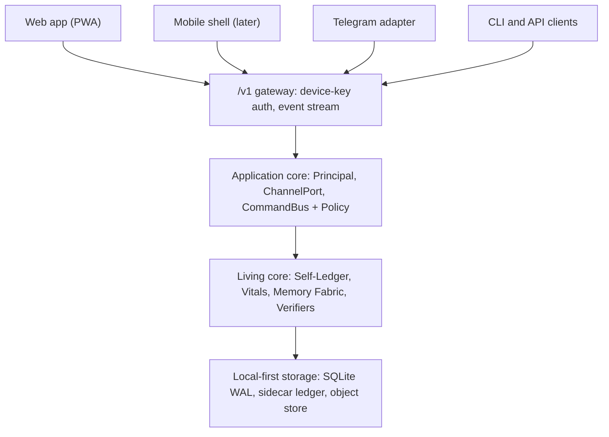

# Product Frame — NEXUS is an app; Telegram is one channel

**Status:** Owner direction stated 2026-10-20 (Majid); the matching `DECISION_LOG.md` entry (proposed D-0029) is **not yet recorded** and waits for explicit owner acceptance.
**Verified against:** `main` @ `14861ba` — every number below is reproducible with the commands in §3.
**Owner zone:** `docs-architecture` · **Builds on:** [OVERVIEW.md](OVERVIEW.md), [LIVING_INTELLIGENCE_ROADMAP.md](LIVING_INTELLIGENCE_ROADMAP.md), [MODULE_MAP.md](MODULE_MAP.md)
**Persian summary:** see §7 (English wins on conflict).

## 1. The frame in one paragraph

NEXUS is a **web/mobile application with a living core** (persistent identity, measured self-state, verified memory, gated self-improvement — see the roadmap). The Telegram bot is **one connector** that can be paired to that application, exactly like the web app, a future mobile shell or the CLI. The bot is not the product, and no design decision may assume it is.

## 2. Rules for every agent

1. **Say "channel", not "the bot".** Features are written as core capabilities behind the command bus and policy; a channel only presents them and relays input.
2. **The core never imports `telegram`.** Framework imports stay at the edge (this is already the frozen-baseline rule in `tests/architecture/test_import_boundaries.py`); the baseline may only shrink.
3. **Canonical identity is a `Principal`, not a Telegram id.** A Telegram `chat_id` / `telegram_user_id` is a *binding* of a channel to a principal. New code must not take a Telegram id as its identity parameter.
4. **A new capability is incomplete until it is reachable without Telegram** (through the application API or the CLI). Telegram handlers are thin adapters.
5. **Do not rewrite working Telegram behaviour to prove a point.** Migration is by characterization test first, then extraction behind a port (§4). No big-bang rewrite, no new service split (the modular-monolith constraint in [OVERVIEW.md](OVERVIEW.md) §4 still holds).
6. **Honest claims.** Nothing in product text says the system is conscious or has feelings; "living" means persistent, self-measuring and self-verifying (roadmap §1).

## 3. Evidence: how far the code is from the frame today

Reproduce on `main`:

```bash
# Files outside bot/ that import the telegram package  -> 5
grep -rln "from telegram\|import telegram" src --include=*.py | grep -v "/bot/"
# Files outside bot/ that carry a Telegram identity     -> 21
grep -rlE "telegram_user_id|chat_id" src --include=*.py | grep -v "/bot/"
# HTTP surface: root page, /healthz, 2 deprecated creative routes, 1 webhook, 2 dashboard and 1 read-only studio route
grep -nE "@(app|router)\.(get|post)" src/nexus_ai_agent/api/*.py
```

The five importers are `agent/self_monitor.py`, `agent/approval.py`, `features/force_join.py`, `features/onboarding.py` and `features/channel_manager.py`. Identity leaks into `storage/models.py`, `orchestration/state.py` and `creative/render_jobs.py`. There is no frontend or mobile directory.

## 4. Target shape and migration ladder



| Step | Change | Exit criterion (observable) |
|---|---|---|
| F0 | This document, `AGENTS.md`, `OVERVIEW.md` | docs-integrity tests green; every agent reads the frame at session start |
| F1 | `Principal` + `ChannelPort`; Telegram becomes an adapter, characterization tests first | the importer count in §3 goes 5 → 0 and an architecture test locks it |
| F2 | Versioned `/v1` API, device-key pairing, event stream, ledger-head witness | contract tests; a test proving tail truncation of the Self-Ledger is detected by the paired device |
| F3 | Read-only PWA (health, ledger, studio jobs with passports), then conversation | installable, offline shell, end-to-end test |

Each step is its own claimed task on the board. F1–F3 are **proposals** until the owner accepts the decision record.

## 5. What this does not change

The offline-first, zero-marginal-cost promise; the single write path through the command bus; deny-by-default access; the evidence-over-assumption rule. Existing Telegram commands keep working throughout.

## 6. Honest limits

The ladder is a plan, not a measurement. The counts in §3 are file counts, not a coupling metric; the identity migration (F1) may touch storage schemas and needs its own design note before any schema change.

## 7. خلاصهٔ فارسی

NEXUS یک **اپلیکیشن وب/موبایل با هستهٔ زنده** است و ربات تلگرام فقط یکی از **کانکتورهای** آن است، نه خودِ محصول. هسته هرگز `telegram` را import نمی‌کند، هویت کانونی `Principal` است (شناسهٔ تلگرام فقط یک اتصال به آن)، و هر قابلیت جدید باید بدون تلگرام هم از راه API یا CLI در دسترس باشد. مهاجرت مرحله‌ای است (F0 تا F3)، با characterization test پیش از هر استخراج و بدون بازنویسی یک‌باره. تا ثبت تصمیم D-0029 توسط مالک، مراحل F1 تا F3 پیشنهادی‌اند.
