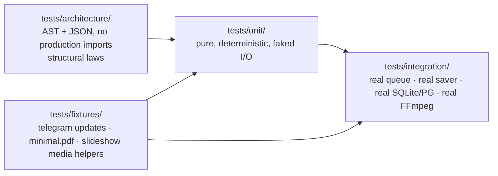

# Testing & Quality Gates

**Status:** Living document
**Scope:** test taxonomy, the four gates, determinism rules, local reproduction, honest gaps
**Verified against:** `main` @ `d6876ab378b88b2ccca1187b1f3c51be5bf52657` (2026-11-19). The numbers in §5 are the 2026-11-19 inventory of this base; the 2026-09-21 baseline they replaced is kept beside it, labelled, because a number without its date and commit is a rumour.

---

## 1. The gate contract

| Gate | Command | Runs in CI | Blocks merge |
|---|---|---|---|
| Lint | `ruff check .` | `lint` job | yes |
| Format | `ruff format --check .` | `lint` job | yes |
| Types | `mypy src` | `lint` job | yes |
| Tests | `pytest -q -m "not slow"` | `test` job | yes |
| Migrations on real PostgreSQL | `nexus migrate` ×2 + 3 contract suites + head assertion | `migrate-postgres` job (`pgvector/pgvector:pg16`) | yes |
| Optional-extras install matrix | one leg per shipping extra + `core` (`test_optional_extras.py`, focused behaviour, skip-inflation audit) | `extras-matrix` job (task-132) | yes |
| Python parity | the `test`-job selection on 3.10 / 3.11 / 3.12 | `python-parity` job (task-132) | yes |
| Release lineage | tags + `VERSION` + lockstep on full history | `release-lineage` job (task-132) | yes |

`make lint && make types && make test` is the local equivalent. **Every agent runs the gates on its own branch and records the evidence (command, result, SHA).** A `gates_owner` claim (`.agents/board.json`) is optional and advisory — policy 2026-10-19 retired the mandatory single-owner rule — so no one must wait for it; still avoid deliberately racing the same CI job.

## 2. Taxonomy



| Layer | What it may touch | Speed | Purpose |
|---|---|---|---|
| architecture | source text only | ms | laws from [`MODULE_MAP.md`](MODULE_MAP.md) §3 |
| unit | pure modules; fakes for LLM/providers; SQLite `tmp_path` | ms–s | behaviour, contracts, failure vocabularies |
| integration | the queue, savers, Alembic, a real FFmpeg encode | s–min | wiring that unit tests cannot prove |

**Determinism rules**
- No network in unit tests; external services are faked (`llm/fake_llm.py`, `tests/unit/surface_fakes.py`).
- Time is injected or frozen; ordering is asserted explicitly (no "usually sorted").
- Golden files (`tests/architecture/legacy_baseline.json`, checkpoint fingerprints, caption/tone fixtures) are **updated by a human-run command** (`nexus checkpoints golden update --yes`), never auto-rewritten by a test run.
- Real binaries are used where "it worked" would otherwise be a guess: the render lane runs genuine FFmpeg encodes supplied by the `imageio-ffmpeg` wheel (a dev extra), and CI installs it.
- Byte stability is asserted where determinism is claimed (canonical JSON, filtergraph strings, `.srt`/`.vtt`/`.ass` output).

## 3. Fitness functions

The files under `tests/architecture/` are the executable form of the boundary laws; the rule → test mapping is maintained in [`MODULE_MAP.md`](MODULE_MAP.md) §3 and must stay in sync (a test without a documented rule, or a rule without a test, is a defect). Nagar's Gate 2 adds R13 for the command boundary; behavioural refusals live in `tests/unit/test_command_capability_contract.py`. They run in the same `pytest` job as everything else — the standard practice for architecture fitness functions ([InfoQ](https://www.infoq.com/articles/fitness-functions-architecture/), [fitness-function pattern](https://aipatternbook.com/architecture-fitness-function)).

### 3.1 API-gate mutation campaign (A-06)

The `api-gate-mutations` job complements (but does not duplicate) `remote-key-mutations`: the latter attacks provider-key and local-cache path containment; this campaign attacks HTTP route ownership and the dashboard, Studio, Telegram-webhook, HMAC, and mounted-container security contracts.

Run it from a clean checkout after `pip install -e ".[dev]"` (the commit-bound runner refuses tracked changes or non-artifact untracked files):

```bash
python scripts/api_gate_mutations.py --report ci-artifacts/api-gate-mutations.json
```

The report is deterministic JSON bound to the checked-out test commit (`git rev-parse HEAD` / `GITHUB_SHA`) and, on pull requests, records and verifies the separate PR head SHA. A dirty tracked checkout or a non-artifact untracked file prevents the campaign from being accepted. Its per-mutation records distinguish `detected`, `survived`, `invalid`, and `not_run`; summary counters (`planned`, `executed`, `detected`, `survived`, `invalid`, `not_run`) are calculated from those records. A mutation is `detected` only when its pinned pytest node fails, the declared failure-oracle marker is present, no unrelated failure/error node appears, and the source bytes are restored. `failure_kind`/`infrastructure_failure_kind` separate import, database, fixture, pytest, unexpected-test, timeout, mutation-anchor, and restoration failures. A baseline failure prevents mutations from running; a passing mutant, missing/ambiguous anchor, import/collection error, timeout, incomplete catalog, report error, or restoration uncertainty exits nonzero and cannot be counted as a kill.

All source anchors must match exactly once and differ from their replacements, preventing silent anchor drift and no-op probes. The runner captures and restores original file bytes, invalidates bytecode, verifies byte equality, and reruns the baseline. The campaign uses the local ASGI test client and temporary test fixtures; it requires no API secrets, external service, or network call. Product files under `src/` are modified only transiently during a mutation and must be unchanged after the run.

**Historical-source limitation:** the fourteen A–N labels and intent are recoverable from the merged PR #226 body and the live source/test anchors, but the temporary historical driver was deleted and is not in Git. `scripts/api_gate_mutations.py` therefore documents an auditable reification of those descriptions; it does **not** claim byte-for-byte recovery of the deleted `SourceEdit` definitions. CI runs the report-producing campaign twice on the same `GITHUB_SHA`, requires byte-identical JSON, verifies the complete 14/14 result and commit binding, emits checksums, and uploads any report that exists with `if: always()`—including when the campaign fails.

## 4. Documentation is tested too

`tests/unit/test_docs_integrity.py` (added with this suite) turns the documentation rules into gates:

| Assertion | Why |
|---|---|
| every file under `docs/` is indexed in `docs/README.md` | an unindexed document is a document nobody reads |
| every relative link inside `docs/` resolves to a real file | dead links are how documentation becomes fiction |
| every ```mermaid fence is balanced, non-empty, and starts with a known diagram type | catches the "empty diagram" and copy-paste mistakes |
| no `TODO`/`FIXME`/placeholder tokens in architecture docs | architecture pages are claims, not notes |
| `VERSION` == `pyproject.toml` == latest `CHANGELOG` heading | the release-drift guard (task-111 partner) |

Documentation linting beyond this (Vale prose linting, `markdownlint-cli2`, Mermaid's own parser via [`mermaid-lint`](https://github.com/jasonworden/mermaid-lint), link checkers such as Lychee — the toolchain GitLab documents in its [docs testing](https://docs.gitlab.com/development/documentation/testing/)) is deliberately **not** wired in yet: it would add a Node/Chromium toolchain to a Python-only CI for a documentation set that is currently < 20 files. The trade-off is recorded in [`adr/0002-docs-as-code-enforcement.md`](adr/0002-docs-as-code-enforcement.md).

## 5. Baseline and measurement standards

### 5.1 Inventory of this base (2026-11-19, `main` @ `d6876ab3`)

```bash
find tests -name 'test_*.py' | wc -l          # 598 test files
# the collected-case count (13 068) is the number the 2026-11-19 audit of this base
# reported for the full suite: python -m pytest --collect-only -q
```

| Metric | Value |
|---|---:|
| Test files | 598 (327 `tests/unit` · 56 `tests/integration` · 57 `tests/architecture` · 157 creative/storage/pack suites · 1 bench) |
| Test functions | 10 061 (static AST count; parametrisation expands them to 13 068 collected cases) |
| Test lines | ≈207 300 |
| Source lines | ≈186 300 across 590 modules under `src/` |

The 2026-09-21 baseline for comparison (same command, older tree): **1106
passed, 23 skipped** in ~61 s with 111 test files. The suite grew roughly
elevenfold in case count since; the *shape* did not change, which is why the
layer rules in §2 still hold.

### 5.2 Benchmark standard (`N = 3`, warm-up, per-workload budgets)

Wall-clock micro-benchmarks live in `tests/creative/atlas/test_wave21_30_benchmarks.py`
and are contracts, not marketing: each operator runs a small / medium / large
synthetic workload and asserts a median budget. Three rules make them honest:

1. **`N = 3` timed samples, median reported.** `max` is printed alongside the
   median but never asserted — a single outlier is information, not a verdict.
2. **One untimed warm-up run precedes the sample loop, with a `reset` hook.**
   The first call of an operator pays first-touch page faults, allocator growth
   and lazily imported `numpy` kernels. Excluding it is the difference between
   measuring the operator and measuring process start-up. The warm-up also
   *produces files* in the two lanes that write artefacts (`master_render`,
   `encode_rgb24_stream`), so `_sample` takes an optional `reset` callback that
   restores the workload's filesystem state before every run — including the
   warm-up. Without it the timed runs would overwrite the warm-up's output
   instead of creating a fresh artefact, which is a different workload (and, for
   a lane that refuses to overwrite, a failure path measured as if it were the
   render).
3. **Budgets are per workload and strict; there is no shared multiplier.** A
   previous revision multiplied every budget by `JITTER_TOLERANCE = 1.25` after
   an audit measured `modal_wind n=1024` at 2053.85 ms against a hard 2000 ms
   cap (2.7 % over) on a shared runner. That factor was the wrong instrument: it
   also lifted the 30 s encode budget to 37.5 s and the 8 s master budget to
   10 s, so a 15–20 % regression would have passed a gate whose whole job is to
   catch it. The audited jitter on that one workload was **2.69 %**; the budgets
   are therefore back at their strict base values (2000 / 3000 / 8000 / 30000 ms)
   and exactly one workload carries a margin: `BOTANICAL_WIND_BUDGET_MS = 2150`
   (7.5 % over 2000 ms) for `modal_wind n=1024`, the only operator that runs
   near its own ceiling on a slow runner (2053.85 ms there vs ~1000 ms in this
   workspace). Keeping the margin local preserves the sensitivity of the other
   seven workloads.

Benchmarks never assert on memory measured process-wide (`ru_maxrss`); where
peak allocation matters the assertion is `tracemalloc`-scoped around the single
operation. One such ceiling did fail outside the CI image for a reason that was
never environmental: `tracemalloc.get_traced_memory()` is a *process-wide*
high-water mark, so it charges the measured operation for every first-touch
allocation that happens to land inside the window. In a lean interpreter that
term reached ~1.9 MB and failed a push whose own residency had not changed
(`peak_bytes=2035495` against a 200 000-byte O(1) budget). The ceiling was not
raised: the test in `tests/storage/personal_cloud_vault/test_sync_journal_manager.py`
now pays that cost with a warm-up push of the same fixture into a throwaway
snapshot before `tracemalloc.start()`, and measures the steady state the budget
is a claim about — 113.6 KB against the unchanged 200 000 / 262 144-byte
ceilings. Measured effect of the warm-up on this workspace: cold 135.7 KB,
warm 113.6 KB.

### 5.3 Coverage standard

* **Per-pack bar: 95 %, enforced by `scripts/pack_coverage.py`.** The run is
  accepted only when it is canonical (27 targets derived from
  `PACK_TEST_TARGETS`, all 7 units, default root, bar 95.0), the measurement is
  verified (child exit 0, zero failed / errored / deselected, nonce-bound trace
  artifact, no orphaned or stale mapping) and every pack is ≥ 95 %. A lowered
  `--threshold` is diagnostic evidence and is never accepted.
* The harness is stdlib-only (`trace` / `dis`), so the coverage verdict does not
  depend on a third-party `coverage.py` version.
* Coverage is a floor on the *pack surface*, not a proxy for behaviour: a line
  that runs without an assertion is not tested. That is what §5.4 exists for.

### 5.4 Mutation standard (adversarial proof, not a percentage)

Every trust plane carries a mutation campaign under `scripts/` — `pack_trust_mutations.py`,
`security_mutations_remote_key.py`, `api_gate_mutations.py`, `execution_core_mutations.py`,
`durable_project_state_mutations.py`, `queue_ownership_mutations.py`,
`creative_redelivery_mutations.py`, `temporal_mutations.py`, `continuum_mutations.py`
and the per-module probes (`task255_mutation_probes.py`, `gate5_mutation_probes.py`, ...).
A campaign is only green when:

* **every mutant is killed** — the pinned pytest node fails, the declared
  failure-oracle marker is present, and no unrelated failure appears; a survivor
  fails the run, and a mutation that could not be applied (`invalid`) is not
  counted as a kill;
* **every source anchor matches exactly once** and differs from its replacement
  (a duplicated anchor would silently mutate only the first occurrence, so
  `tests/unit/test_mutation_harness_anchors.py` ratchets uniqueness);
* **the restored bytes are verified** by hash, and the baseline is re-run green
  afterwards, so the campaign cannot pass by leaving the tree weakened;
* **the campaign may also live beside the tests it mutates.** `tests/architecture/test_cp4_fence_protocol_mutations.py`
  is an in-tree campaign (28 mutants) for the guarantees that "looks correct" used
  to satisfy: the two-phase S3 GC fence and its CP5 hardening in
  `storage/personal_cloud_vault/byos_drivers.py` — the ABA chunk-generation proof,
  the bucket-clock anchor that makes lease expiry immune to a lagging writer, and
  the mandatory `ETag` precondition before a fence is retired — the CP6 lease
  ownership state machine (a reap that trusts the read it took one round trip
  earlier, a rollback that writes without proving the object is still its own, a
  reap that degrades to an unconditional `DELETE` when no `ETag` is reported, and a
  release path that treats an empty `ETag` as a licence to delete), the CP6 chunk
  identity `(version-id, generation stamp, ETag)` (an identity reduced to the
  content `ETag`, and an unknown identity treated as unchanged), the mandatory
  anchor of `verify_manifest_integrity_strict`, and the non-finite guards in the
  loudness core and in the Wiener denoiser's scalar and `clean_reference`
  contracts. The CP6.1 follow-up hardens the same two paths one layer further: a
  refresh that PUTs without an `ETag` precondition, a refresh that reads an
  unreadable or already-moved prior lease as "there was none" (and then rolls it
  back into a delete), a release that trusts a fresh read of the object instead of
  the write it recorded for itself, and a chunk identity that ignores the
  generation stamp whenever the bucket is unversioned. Each mutant is applied to a
  hardlink copy of `src/` and `tests/`,
  parsed with `ast.parse` before it is scored, and run in its own subprocess — so
  no C extension (`numpy`, `scipy`, `PIL`, `sqlalchemy`) is ever reloaded
  in-process — and a kill counts only on pytest exit code 1 with a named
  `FAILED test_...` node that *is* the test owning that guard; a mutant killed by
  an unrelated test fails the campaign.
* AST-level checks are used where a text edit would be ambiguous: the campaigns
  parse the mutated module with `ast.parse` before running, so an edit that
  produces a syntactically different program is rejected as an invalid mutant
  instead of being scored as a kill.

Campaigns run in their own CI jobs (they are slow and they write to `src/`
transiently); the report is deterministic JSON bound to `git rev-parse HEAD`.

### 5.5 Subprocess isolation rule (`python -I`)

Tests that must prove something across a *process* boundary spawn the child with
`python -I` — isolated mode is the point: no `PYTHONPATH`, no CWD, no user
site-dir, so the parent cannot leak an import into the child. The cost is that a
source checkout is invisible to the child (`-I` also hides `src/layout`), and it
dies with `ModuleNotFoundError` before running a line — which is exactly what
happened to the two `selfhood` tests at this base. **The flag is never the
thing to remove.** Inject the absolute `src` path of the tree under test into the
child's `sys.path` from inside the child script (`tests/unit/test_selfhood_ledger.py`
has the canonical `_child()` helper), so the child still loads the code under
test and the isolation stays intact.

**The editable-install gotcha (historical, still worth knowing):** running
`pytest` with only `PYTHONPATH=src` used to fail a handful of tests for purely
environmental reasons — subprocess tests that cannot import a non-installed
package, and `test_version_command::test_running_version_matches_installed_distribution`,
which needs distribution metadata. `pip install -e . --no-deps` fixes those.
The subprocess ones are now fixed at the source (§5.5) rather than by the
installer, and CI installs the package properly either way.

## 6. Reproducing the numbers in these documents

```bash
# file/line inventory (OVERVIEW §8)
find src -name '*.py' | wc -l; find src -name '*.py' -exec cat {} + | wc -l

# operation inventory (CREATIVE_STUDIO §4–5)
nexus packs list

# migration chain (DATA_AND_STORAGE §2)
ls migrations/versions/

# locale/key parity (this file + i18n)
pytest -q tests/unit/test_i18n_parity.py

# docs gates
pytest -q tests/unit/test_docs_integrity.py

# repository truth gates (all four must be green before a push)
python -m nexus_ai_agent.nagar --check
python scripts/check_board_integrity.py
python scripts/check_version_lockstep.py
python -m nexus_ai_agent.diagnostics.truth --root .
```

## 7. Known gaps (stated, not hidden)

| Gap | Impact | Where it is tracked |
|---|---|---|
| No full Mermaid syntax validation (structural checks only) | a syntactically invalid diagram could pass the gate | [`adr/0002`](adr/0002-docs-as-code-enforcement.md) — adopt `mermaid-lint` if `docs/` grows past ~30 files |
| Optional heavy extras are not exercised in the default CI job | a broken optional path may survive until a user opts in | CLOSED for the shipping extras by the `extras-matrix` CI job (task-132, legs `core`/`pdf`/`speech`/`translate` + skip-inflation audit); heavy *core* deps (Chroma/sentence-transformers) stay covered by unit/fail-closed tests only, and `[local-llm]` never existed as an extra |
| PostgreSQL suites skip locally without `NEXUS_DATABASE_URL` | local confidence is lower than CI confidence | CI `migrate-postgres` job |
| No browser/E2E UI test | the dashboard is HTML-by-render, not a UI framework | deliberate: see [`OVERVIEW.md`](OVERVIEW.md) §7 (dashboard is read-only by design) |
| P0-8/P0-9 have no guard test yet | engine double-wiring and empty graph memory can return unnoticed | board **task-124** [`SECURITY.md`](SECURITY.md) §3 |
| `tracemalloc` ceilings are sensitive to what the local interpreter has already imported | a streaming-residency assertion can fail on one machine and pass on another with identical code (`test_n1_streaming_push_o1_tracemalloc_ceiling_and_disk_locator_healing` failed in a minimal local virtualenv and passed in the CI image at this base) | resolved: the test warms the code path before `tracemalloc.start()` and asserts the unchanged 200 000-byte ceiling on the steady state (§5.2); any future ceiling must do the same rather than widen the number |
| Some mutation campaigns are still manual (`make mutations` covers only two of them) | a trust plane can lose its adversarial proof without anything turning red | board **task-260** (execution-core campaign as a CI job) |

## 8. Adding a test

| You changed | Minimum evidence |
|---|---|
| a pure pack operation | one deterministic unit test + the pack's purity gate still green |
| a port or adapter | a contract test against the fake *and* the real backend (unit + integration) |
| a boundary (imports, process spawn, manifest) | a fitness function in `tests/architecture/` **and** a row in [`MODULE_MAP.md`](MODULE_MAP.md) §3 |
| a failure path | an assertion that the failure is typed and the user-visible message is localised |
| documentation | `pytest -q tests/unit/test_docs_integrity.py` |
| a release | `VERSION` + `pyproject.toml` + `CHANGELOG` head all in lockstep (task-111 guard) |
