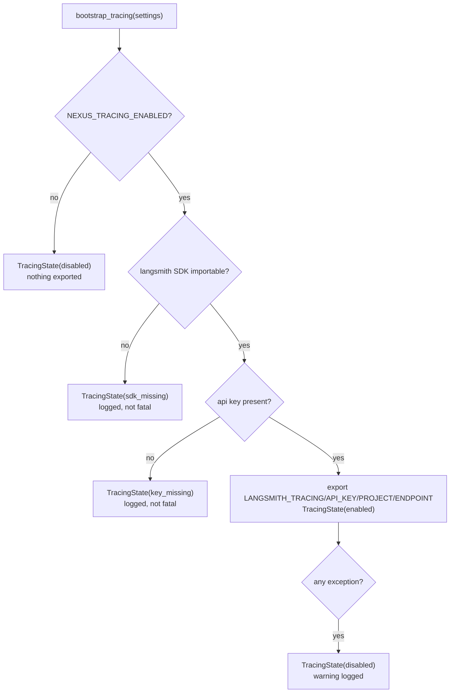

# Tracing (opt-in LangSmith)

**Status:** Living document
**Scope:** the opt-in LangSmith trace export — the switch, the fail-closed bootstrap, the connectivity smoke, and the honest limits
**Verified against:** `main` @ `cf8b7f6`

The runtime is built on LangGraph, and LangGraph/LangChain already know how to emit
traces to LangSmith through the `LANGSMITH_*` environment variables. This document
describes the **one** place that decides whether those traces leave the process, so
the decision is explicit, testable, and impossible to turn on by accident.

Tracing here follows the same three rules as the rest of observability
(§[`OBSERVABILITY.md`](OBSERVABILITY.md)): **dependency-free by default**
(the SDK is an extra, never a core import), **off unless asked** (enabling it is an
explicit egress decision), and **never fatal** (a tracing failure can never break a
request).

---

## 1. The switch

| Property | Value |
|---|---|
| Enable | `NEXUS_TRACING_ENABLED=true` (default `false`) |
| Key | `NEXUS_TRACING_API_KEY` (falls back to `LANGSMITH_API_KEY`) |
| Project | `NEXUS_TRACING_PROJECT` (default `nexus-ai-agent`; falls back to `LANGSMITH_PROJECT`) |
| Endpoint | `NEXUS_TRACING_ENDPOINT` (default `https://api.smith.langchain.com`) |
| SDK | `langsmith` (ships with the core install: `langgraph` → `langchain-core`) |

Tracing is **off** unless the enable flag is set. Turning it on is a deliberate
choice because it exports user prompts to a third party; the default must never
do that silently.

## 2. The bootstrap

`observability/tracing.py::configure_tracing` is pure with respect to its arguments
and mutates the environment **only on the active path**, so a partial configuration
can never leave a half-enabled state behind. It returns a typed `TracingState`
(`active`, `reason`, `project`) rather than a bare boolean, so callers and tests can
branch on *why*.

`bootstrap_tracing(settings)` wraps `configure_tracing` in a broad guard: a tracing
failure is an observability failure, and observability failures are never fatal here.
The bot calls it once, right after logging exists (`cli.py::run_bot`), so the outcome
is visible in the log stream.

## 3. The connectivity smoke

`scripts/langsmith_smoke.py` proves the configured key can actually accept a trace.
It is a *connectivity* check, not a unit test, so it fails **visible**, never green:

| Situation | Output | Exit |
|---|---|---|
| `LANGSMITH_API_KEY` unset | `RESULT=SKIPPED_NO_SECRET` | 0 |
| SDK missing | `RESULT=FAILED DETAIL=...` | 2 |
| Endpoint refuses the key | `RESULT=FAILED DETAIL=<ErrorType>` | 1 |
| Trace accepted | `RESULT=OK` | 0 |

A missing secret is a visible skip; a fabricated pass would be the exact lie this
check exists to prevent. The workflow `.github/workflows/langsmith-smoke.yml` runs it
on `workflow_dispatch` and on changes to the tracing module, script, or workflow.
(It replaces the orphan `langsmith-connectivity-smoke-20261026.yml` registration whose
branch was deleted, leaving a workflow with no source file.)

## 4. Honest limits

- **Tracing is not metrics or alerting.** A trace is a debugging aid; the alert list
  stays in §[`OBSERVABILITY.md`](OBSERVABILITY.md) §6. Nothing here is a signal to
  page on.
- **Traces contain prompts.** This is exactly why the switch defaults off and why the
  tracing key must be a *tracing-only* key (LangSmith scopes let such a key write runs
  but not read projects/settings), so a leaked key cannot exfiltrate other tenants' data.
- **The smoke proves ingest, not correctness.** `RESULT=OK` means the endpoint accepted
  a run; it says nothing about whether a given graph emitted the traces you wanted.
- **No CI leg needs the secret.** The unit suite (`tests/unit/test_tracing_bootstrap.py`)
  proves every non-egress branch without a key; only the smoke job needs the secret, and
  it degrades to a visible skip without one.

## 5. Adding a traced surface

1. Keep the SDK behind the `tracing` extra; never import `langsmith` at module top level
   in core code (deptry fails the lint gate).
2. Call `bootstrap_tracing(settings)` once, at startup, after `configure_logging`.
3. Do not read `TracingState` to gate business logic — tracing is observation only.
4. If you add a traced surface worth verifying, extend `scripts/langsmith_smoke.py`
   rather than adding a new workflow.
