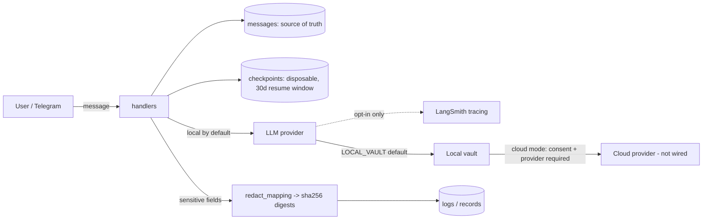

# NEXUS-OMNI — Security & Privacy Audit (2026-11-03)

> **Status:** dated record. Mission `NEXUS-OMNI-FORENSIC-RECONSTRUCTION-2026-11-03`,
> branch `arena/omni-audit-reports`. Base `main` @ `5ce9f7d3`. Framework: STRIDE +
> OWASP, with every finding tied to a real code path and an enforcing test.
> No secret value, token, or user datum appears in this document.

## 1. Method & tooling

| Tool | Command | Result |
|---|---|---|
| Bandit | `bandit -r src/` | 0 High, 20 Medium, 125 Low (see §3) |
| Manual grep | `eval(`/`exec(`/`pickle`/`marshal`/`yaml.load`/`shell=True`/`os.system` | no true dangerous call (see §4) |
| Secrets sweep | regex over `src/`, `scripts/`, `git ls-files` | none tracked; `.env.example` holds empty keys only |
| Workflow review | line-by-line `.github/workflows/*.yml` | see the CI/CD report §5 |

## 2. Identity & authorization

**Canonical identity.** `application/principal.py` defines `PrincipalId`
(`prn_` + 32 hex, `secrets.token_hex`) and `ChannelBinding` (one external
account → one Principal). Core code holds a `PrincipalId`, never a Telegram id.
A binding conflict is a typed `BindingConflictError`.

**Authorization is a trusted seam, not request JSON.** Two independent seams
refuse to mint a grant from caller input:

- `creative/studio/authorization.py` — the envelope actor is a *claim*;
  `ProjectAccess.authorize()` raises `AuthorizationError` unless actor **and**
  project match, and `require_permissions()` checks the permission is a subset.
- `creative/assets/authz.py` — `StudioAuthorizationSeam` translates the seam's
  errors into `AuthorizationFailure`; `GrantTableAuthorizer` denies unknown
  `(actor, project)` pairs ("absence is never a grant").

**HTTP surface.** `/dashboard` is bearer-token gated (`require_dashboard_token`,
constant-time `hmac.compare_digest`, fail-closed 401). The deprecated
`/creative/video-edit` (POST) and `/creative/jobs/{job_id}` (GET) both run
`require_hmac_signature` **before** any body parse; without a configured
`NEXUS_API_HMAC_KEY` they answer `503` (fail-closed). `/webhook/telegram`
compares `NEXUS_WEBHOOK_SECRET` constant-time and returns `403` on mismatch,
`503` when the app is not ready (so Telegram retries rather than drops).
`/studio/projects/{id}/...` requires the dashboard token, validates the project
id against a regex, and returns an indistinguishable `404` for unconfigured vs
unauthorized projects (no existence oracle).

**IDOR / cross-tenant.** `StudioReadService` hides cross-project job existence
(`ProjectReadDenied → 404`, row never returned). Tenant isolation is
project-scoped at the seam; the composition root is responsible for injecting a
real membership store.

## 3. Bandit findings — all reviewed, none exploitable

### B608 "possible SQL injection" (14 sites)
`checkpoint_lifecycle_store.py`, `checkpoint_lifecycle_pg_store.py`,
`provenance/journal.py`, `maintenance/backup.py`, `adapters/effect/outbox_dispatcher.py`.

**Verdict: false positive.** Every flagged `f-string` interpolates only a
**module-level constant identifier** (`{_TABLE}`, `{_ROW_COLUMNS}`, a
hardcoded table name), never a runtime value. All user/row values are bound
parameters (`?`, `%s`). The one quoted identifier in `backup.py`
(`f'SELECT COUNT(*) FROM "{table}"'`) is sourced from
`sqlite_master` — the database's own table list, not user input. No reachable
injection path.

### B108 "insecure temp file" (3 sites) — `creative/rendering/bench.py`
Benchmark helper; used in a controlled rendering path, not for security-
sensitive storage. **P3**, no fix required now.

### B104 "binding to all interfaces" — `bot/webhook.py:95`
Deliberate: the webhook server must bind `0.0.0.0` to receive Telegram
deliveries in a container. Access is gated by the secret-token check in §2.
**Accepted, documented.**

### Low findings (125)
Predominantly `B603 subprocess_without_shell_equals_true` in
`tools/system_shell.py`. This is the *point* of that module: it runs an
allowlisted argv with `shell=False` and `cwd` fixed to the workspace (§4).

## 4. Injection & code execution

`grep -rnE "eval\(|exec\(|pickle|marshal|yaml.load|shell=True|os.system|os.popen"`
returns **no true dangerous call** in `src/` (the `exec(` hits are SQLModel
`session.exec()`; the single `shell=True` string is an argument name
`ShellTool(enable_shell=True)`, not a `subprocess` kwarg).

**Shell tool** (`tools/system_shell.py`) is the highest-risk surface and is
defended in depth:

- **M1 — declared flag grammar.** Every allowlisted command has an explicit
  flag table; an undeclared flag is *refused*, so a future coreutils option
  cannot be reached. Each flag declares how many tokens it consumes and their
  kind (`bool`/`value`/`path`/`optional_value`/`tuple`).
- **M2 — path-shaped argument net.** Any token that lexically denotes an
  absolute/traversing path is validated against the workspace boundary in any
  position and spelling.
- Both route through `WorkspaceFilesystem`, which rejects absolute paths, `..`,
  NUL bytes, non-POSIX spellings, and any path with a symlink component.
- Symlink-following options (`ls -L`, `grep -R`, `find -follow`, …) are refused
  outright because no path validation can contain them; the safe siblings are
  allowed. This was *measured*, not assumed (the module docstring records the
  `grep -R TOP_SECRET .` reproduction).
- Commands run with `shell=False`, `cwd=workspace root`, `timeout=10`.

**Archive extraction:** no `extractall`/`zipfile`/`tarfile` in `src/` — no
Zip-Slip surface exists in first-party code.

**Filesystem policy:** `tools/filesystem_policy.py` resolves and re-checks
`is_relative_to(root)`, rejects symlink components, and guards the
resolve-then-open race (`_open_dir`, inode checks).

## 5. Network security (SSRF)

`core/ssrf_guard.py` is a mature, layered defence:

- `validate_url` — **https-only**, and *every* address from `getaddrinfo` must
  be public.
- `SafeAsyncTransport` — re-resolves and re-checks at **each** TCP connection
  through a wrapped httpcore backend, connecting to the validated IP literal so
  a second DNS lookup cannot swap the address (closes TOCTOU / DNS-rebinding).
- Blocked ranges include 127/8, 10/8, 172.16/12, 192.168/16, 169.254/16 (cloud
  metadata), 0/8, 100.64/10 (CGNAT), ::1, fe80::/10, fc00::/7, with explicit
  IPv4-mapped normalisation so stdlib CVE-2024-4032 semantics cannot open a gap.
- https→http redirect downgrades are refused at the transport boundary.

Enforcing tests: `test_api_ssrf_download.py`, `test_http_client_ssrf.py`,
`test_summarizer_ssrf.py`.

## 6. Cryptography

- HMAC-SHA256 request signing with a ±300 s freshness window and
  `compare_digest` (constant-time). See §2.
- Webhook secret and dashboard token use `secrets.compare_digest` /
  `hmac.compare_digest`.
- Identity tokens from `secrets.token_hex`. No `random` used for security
  material in the reviewed paths.
- A token-encryption module was **reverted** historically ("no consumer exists
  yet", commit `777f5371`) — correct: no unused crypto to maintain.

## 7. Agent & LLM security (highest-value area)

The mission's architectural law — **Intent ≠ Authority** — is implemented and
tested, not merely documented:

- `nagar/cognition/gateway.py` is the *single* path from a model to execution:
  `intent → offered_operations(registry) → DeterministicRouter → CognitionPort
  → TypedProposal → proposal_to_command → CommandBus`.
  Invariants, each a test: **never MODEL→EXECUTION**; offered operations come
  from the registry, never the model; a `blocked` router decision yields a typed
  refusal (no raw-model fallthrough); the actor/project/schema-version come from
  the composition root — *a proposal cannot self-grant*.
- `nagar/ibpc/authority.py` + `test_ibpc_authority.py` enforce the boundary.
- LLM degradation (`fallback_provider.py`) is decided by **typed error kind**,
  never by scanning model text (LAW 10) — a response that merely mentions "429"
  stays a success. A non-retryable/untyped error propagates; it is never
  silently replaced.
- No unbounded autonomous loops in the reviewed execution path: the gateway
  terminates in a CommandBus decision or a typed refusal.

## 8. Privacy

**Three modes** (`nagar/ibpc/privacy.py`): `LOCAL_VAULT` (**default**),
`TRUSTED_CLOUD`, `EXPERIMENTAL_CLOUD`.

- `check_egress` under `LOCAL_VAULT` **raises** `PrivacyViolation` outright.
- Under a cloud mode it refuses without a recorded `ConsentRecord`, and — even
  with consent — returns a typed `no_provider_wired` refusal, because no cloud
  provider is wired in this slice. **User data is never sent to an unknown
  provider.** This is enforced, not aspirational.
- `redact_mapping` replaces sensitive fields (`transcript`, `text`, `audio`,
  `prompt`, `content`, …) with `sha256:` digests before any log/record — raw
  transcript/audio never enters a record. Enforcing test: `test_ibpc_privacy.py`.

**Tracing / telemetry.** `observability/tracing.py` is opt-in and fail-closed:
`NEXUS_TRACING_ENABLED` is the *only* authority; a stray `LANGSMITH_TRACING`
cannot enable it, and every non-active outcome clears the SDK flags. Enabling it
exports prompts to a third party, so the switch is explicit and the outcome is
always reported. `langsmith-smoke.yml` uses a tracing-scoped key (read of
org/projects returns 403 by design).

**Retention.** `docs/architecture/RETENTION_DECISION.md` fixes the resumability
window (30 days) separately from message retention; unknown timestamps are
*protected*, not treated as old; the cleanup circuit-breaker is fail-safe (1% /
500 anomalies). `DATA_LIFECYCLE.md` states checkpoint deletion must never delete
messages, and destructive unit is the whole thread.

### Privacy data-flow map

### Data retention matrix

| Data | Store | Retention | Egress |
|---|---|---|---|
| Messages | DB (source of truth) | independent of checkpoints | none by default |
| Checkpoints | DB / LangGraph | 30-day resumability window | none |
| Transcript / audio | local vault | session; digests in records | refused unless cloud mode + consent |
| Logs | structlog | redacted; digests for sensitive fields | none |
| Traces | LangSmith | opt-in only | explicit operator switch |
| Backups | R2 (`backups/db/`) | 30 days (housekeeping) | owner-configured bucket |

**Honest gap:** the three privacy modes are enforced inside the IBPC slice; the
legacy Telegram chat path does not route through `PrivacyPolicy`. This is a
**documented boundary**, not a silent hole (see the morning handoff "Next").

## 9. STRIDE summary

| Threat | Control | Status |
|---|---|---|
| Spoofing | Principal identity, HMAC/bearer/secret gates | enforced |
| Tampering | constant-time signatures, freshness window | enforced |
| Repudiation | provenance journal, consent records | enforced |
| Information disclosure | redaction, LOCAL_VAULT default, SSRF guard, IDOR 404 | enforced |
| DoS | rate limits (image gen 1/30s, memory egress), bounded responses, timeouts | partial (see gaps) |
| Elevation of privilege | trusted authz seam, Intent≠Authority gateway | enforced |

## 10. Findings & disposition

| ID | Severity | Finding | Disposition |
|---|---|---|---|
| SEC-1 | P2 | malformed `R2_BUCKET` → opaque `ParamValidationError` (no secret leak, but fail-late) | **FIXED** — PR #305 |
| SEC-2 | P3 | `bench.py` insecure temp dir (B108) | accepted (benchmark only) |
| SEC-3 | P3 | `0.0.0.0` bind (B104) | accepted (container webhook, secret-gated) |
| SEC-4 | P2 | legacy Telegram chat path bypasses `PrivacyPolicy` | documented boundary; owner decision |
| SEC-5 | P3 | per-user rate limits are in-process (lost on restart) | documented in `ai_memory.py` |

No P0 (exploitable / data-loss / authority-breach / cross-tenant) finding was
proven. The security architecture is strong: the interesting risks are at the
*integration seams* (legacy paths, composition-root wiring), not in the
reviewed primitives.

---

# SEC-4 — unified LLM-egress authorization boundary (decision package)

Status: **BLOCKED_OWNER_DECISION**. Nothing here is implemented; this is the
contract the owner must approve before any runtime policy authority is added.
(`docs/DECISION_LOG.md` is under the active `task-nagar-workspace-redelivery-01`
lease, so the package is recorded here rather than there.)

## Problem

The legacy Telegram `/ai` path egresses user text to Google with no privacy gate:
`bot/handlers.py::ai_cmd` → `features/ai_chat.py::GeminiEngine.chat` →
`httpx POST generativelanguage.googleapis.com`. The existing IBPC `PrivacyPolicy`
is imported only by `continuum/pack_coverage.py`; the AI-memory consent gate
(`ai_memory_consent`) is a **different scope** (memory storage, not provider
egress). Patching the handler directly would create a **third partial policy
authority**, which the architecture forbids.

## Egress inventory (provider-facing routes)

| Route | Entry | Data category | Provider | Consent today | Privacy mode |
|---|---|---|---|---|---|
| `/ai` | `bot/handlers.py::ai_cmd` | free text + optional image | Google Gemini | none | none |
| `/ask` | handlers → ai_chat | free text | Google Gemini | none | none |
| `/code` | handlers → ai_chat | free text | Google Gemini | none | none |
| `/translate` | handlers → translate extra | free text | local Argos (offline) | n/a | LOCAL_VAULT |
| `/vision` | handlers → ai_chat | image + text | Google Gemini | none | none |
| summarizer | `features/*` → ai_chat | free text | Google Gemini | none | none |
| AI Memory | `memory/*` | text/embeddings | local + optional cloud | `ai_memory_consent` | memory scope only |
| RAG | `features/rag.py` | corpus text | local chroma / embeddings | none | LOCAL_VAULT |

## Option A — unified provider-egress boundary

One `LLMEgressAuthorizer` at the composition root; every provider call passes
through `authorize(principal, tenant, project, data_category, provider,
purpose)`. Default-deny under LOCAL_VAULT.

* Pros: single authority; scope-specific consent; easy to reason about.
* Cons: a new interface touching every call site; migration cost; risk of
  becoming a second policy engine beside IBPC if not carefully delegated to.

## Option B — route legacy paths through the existing LLM gateway (recommended)

The repository already has a provider gateway (`litellm` provider / model
routing). Route `/ai`, `/ask`, `/code`, `/vision`, summarization, AI Memory and
RAG through it, and integrate **one** authorization check at the gateway's
provider-call boundary. Legacy Gemini becomes one provider behind the gateway.

* Pros: no new authority (reuses the gateway that already owns provider selection);
  one place to enforce; IBPC stays the policy source, not duplicated.
* Cons: gateway must expose a pre-call hook; needs a migration of the legacy
  Gemini engine to a gateway provider; must preserve streaming behaviour.

## Shared invariants (both options)

`Intent ≠ Authority`; LOCAL_VAULT default-deny; consent is scope-specific
(`ai_memory_consent` never implies chat/image egress); principal + tenant +
project binding; explicit provider and data-purpose identification; expiration +
revocation; re-check before retry; typed refusals; redaction before logging; no
cloud provider activation without explicit approval.

## Recommendation

**Option B.** It satisfies "one egress authority" without inventing a second
policy engine, and the gateway already exists.

## Owner decisions required

1. All external LLM egress default-deny under LOCAL_VAULT? (recommended: yes)
2. Which consent scope permits ordinary chat egress? (new `provider_egress` scope)
3. Does existing `ai_memory_consent` remain memory-only? (recommended: yes)
4. How are consent records persisted and revoked?
5. Which composition root owns the unified gate?
